<p align="center"><a href="https://johnmorrisdotca.github.io/taisen-brackets/"><picture><source media="(prefers-color-scheme: dark)" srcset="https://raw.githubusercontent.com/johnmorrisdotca/taisen-brackets/main/docs/images/thumbnail-dark.png">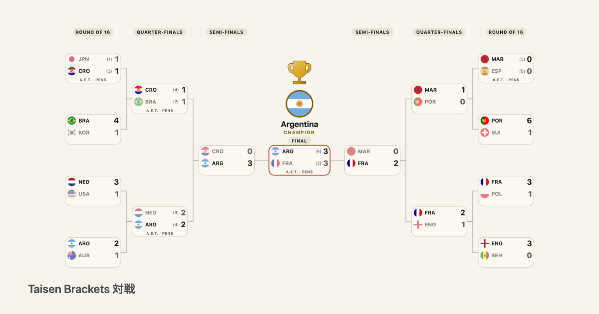</picture></a></p>

<h1 align="center">Taisen Brackets <sub>対戦</sub></h1>

<p align="center"><strong>Knockout brackets as SVG, from a list of ties.</strong><br>
Give it the games, series, two-legged ties or replays of a tournament and it works out the rounds, the halves, the byes and who feeds whom, then draws the bracket: two halves that meet at the final, or one tree left to right, wide, square or tall for a phone, in light, dark or a gold-on-navy poster look, with each team's logo or round flag, the champion in the centre, and a table for readers the drawing does not serve. NHL, NBA, MLB, NFL, CFL, MLS and World Cup formats by era, in English, French, Japanese, Spanish and German. One function, no dependencies.</p>

<p align="center">
  <a href="https://github.com/johnmorrisdotca/taisen-brackets/actions/workflows/ci.yml"></a>
  <a href="https://www.npmjs.com/package/@johnmorrisdotca/taisen-brackets"></a>
  <a href="./LICENSE"></a>
  
  
</p>

<p align="center"><a href="https://johnmorrisdotca.github.io/taisen-brackets/"><strong>Open the demo →</strong></a> · <a href="./docs/layout.md">Layout</a> · <a href="./docs/layouts.md">Layouts</a> · <a href="./docs/every-sport.md">Every sport</a> · <a href="./docs/drawing.md">Drawing</a> · <a href="./docs/road.md">Road to the final</a> · <a href="./docs/backgrounds.md">Backgrounds</a> · <a href="./docs/judo.md">Judo</a> · <a href="./docs/rankings.md">Rankings</a> · <a href="./docs/medals.md">Medal table</a> · <a href="./docs/broadcast.md">Broadcast boards</a> · <a href="./docs/formats.md">Formats</a> · <a href="./docs/compare.md">How it compares</a></p>

<p align="center">
<picture>
<source media="(prefers-color-scheme: dark)" srcset="https://raw.githubusercontent.com/johnmorrisdotca/taisen-brackets/main/docs/images/hero-desk-dark.webp">
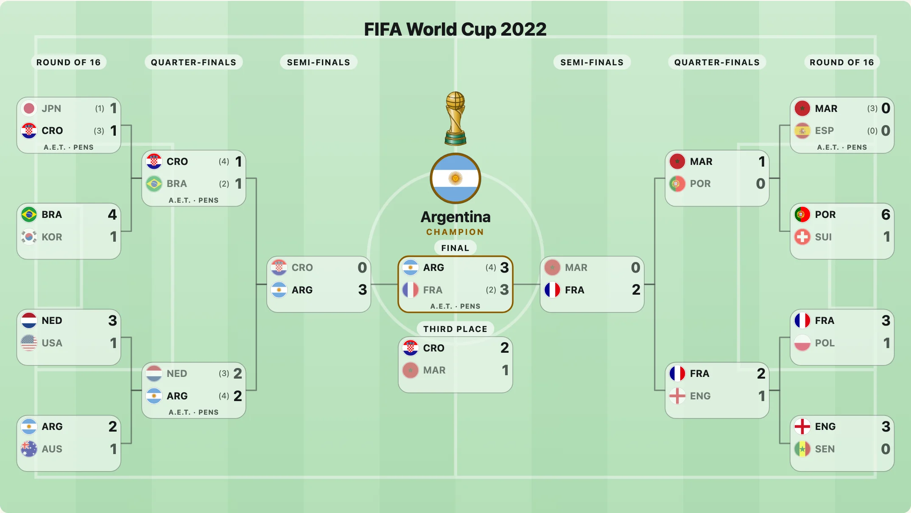
</picture>
</p>

## The best of it

The moving pictures below are drawn by the package from the demo's own data and made by `pnpm animations` (slowly, a step at a time) and `pnpm images`. In the demo they stand still until the pointer is over them (a tap on a phone) and Play and Pause work as well. Brackets of every sport and layout are in [Every sport](./docs/every-sport.md) and [Layouts](./docs/layouts.md).

### A bracket filling in, game by game

<p align="center">
<picture>
<source media="(prefers-color-scheme: dark)" srcset="https://raw.githubusercontent.com/johnmorrisdotca/taisen-brackets/main/docs/images/hero-fill-dark.webp">
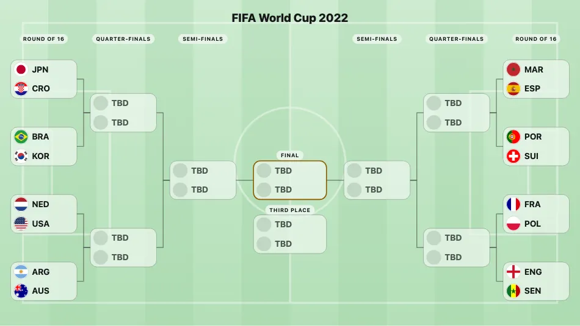
</picture>
</p>

The same `drawBracket` call, drawn again after each game with the ties not yet played empty and the feeding tie named; the demo opens on the finished bracket and plays it from the first game when the pointer is over it.

### Judo: the scoreboard, flip cards and the mat queue

<p align="center">
<picture>
<source media="(prefers-color-scheme: dark)" srcset="https://raw.githubusercontent.com/johnmorrisdotca/taisen-brackets/main/docs/images/judo-flip-dark.webp">
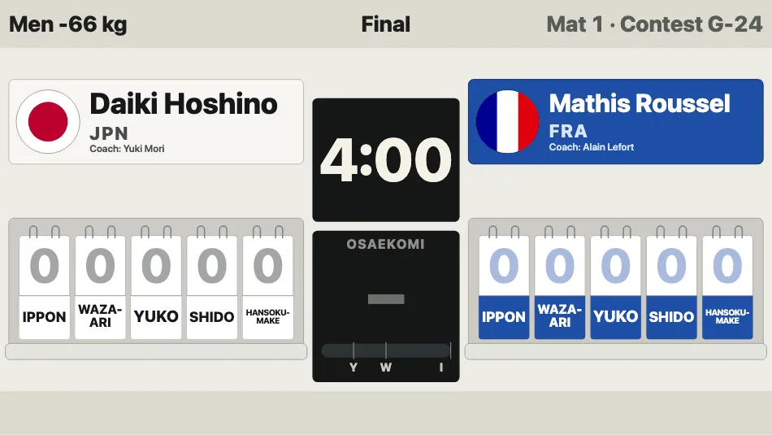
</picture>
</p>
A judo contest is a tie with a `judo` result (ippon, waza-ari, yuko, shido, golden score, the contest time) scored as the IJF's current rules score it. `judoBracket` makes a weight category's bracket with the repechage and two bronze medal contests, `judoScoreboard` draws one contest as a board or as flip cards, and `judoContestCard` and `judoMatQueue` are the screens for the hall. [docs/judo.md](./docs/judo.md) · [the guide](./docs/guides/judo-rankings-and-boards.md).

<p align="center"><picture>
<source media="(prefers-color-scheme: dark)" srcset="https://raw.githubusercontent.com/johnmorrisdotca/taisen-brackets/main/docs/images/judo-desk-dark.webp">
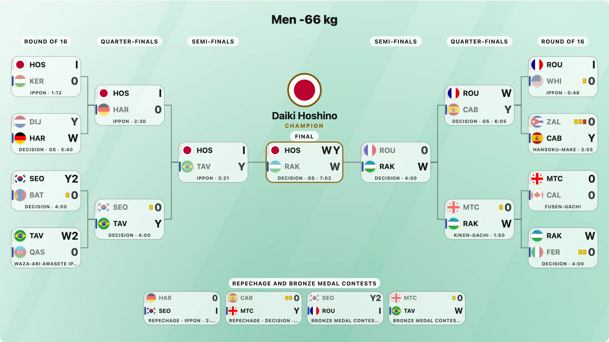
</picture><br><em>Men's -66 kg, with the quarter-final repechage (invented names).</em></p>

<p align="center">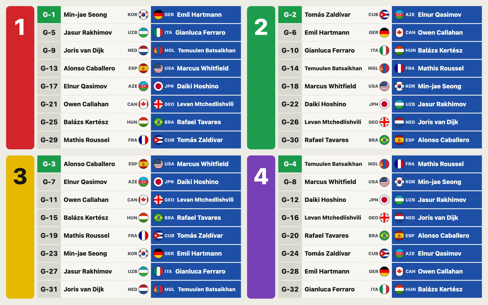</p>
<p align="center"><em>The mat queue (invented athletes).</em></p>

### Rankings, in the style of a provincial federation

<p align="center">
<picture>
<source media="(prefers-color-scheme: dark)" srcset="https://raw.githubusercontent.com/johnmorrisdotca/taisen-brackets/main/docs/images/ranking-live-dark.webp">
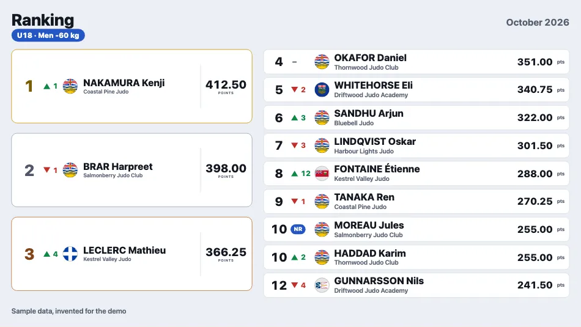
</picture>
</p>
`rankingList` draws a ranking for any ranked sport from your own data, text first, with no photo slot to leave empty: the rank, a flag, the name, the club and the points, with the movement since the last list. `rankingNumberOnes`, `rankingEntryList` and `rankingMatchup` draw the number ones, an entry list and a head-to-head card. [docs/rankings.md](./docs/rankings.md) · [the guide](./docs/guides/judo-rankings-and-boards.md#a-ranking-list).

<p align="center"><picture>
<source media="(prefers-color-scheme: dark)" srcset="https://raw.githubusercontent.com/johnmorrisdotca/taisen-brackets/main/docs/images/ranking-podium-tv-dark.webp">
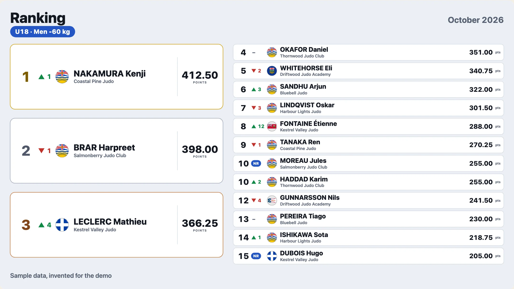
</picture><br><em>A made-up provincial ranking (invented names and clubs).</em></p>

### Broadcast boards

`resultsBoard`, `boutBoard` and `broadcastMedalTable` draw a results graphic, a bout presentation and a medal table, each as one standalone SVG to place over a picture, in three looks and with no mark of any games. [docs/broadcast.md](./docs/broadcast.md) · [the guide](./docs/guides/judo-rankings-and-boards.md#broadcast-boards).

<p align="center"><picture>
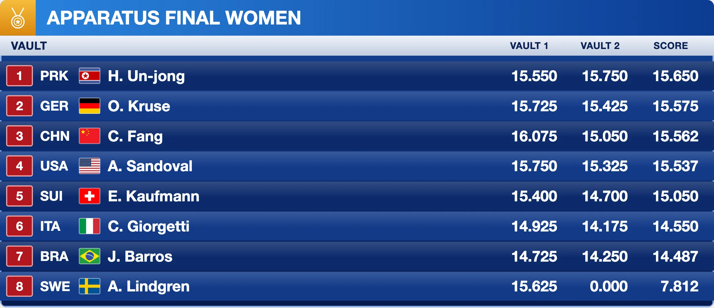
</picture><br><em>A made-up apparatus final (invented athletes and scores).</em></p>

### Medal table

<p align="center">
<picture>
<source media="(prefers-color-scheme: dark)" srcset="https://raw.githubusercontent.com/johnmorrisdotca/taisen-brackets/main/docs/images/medals-live-dark.webp">
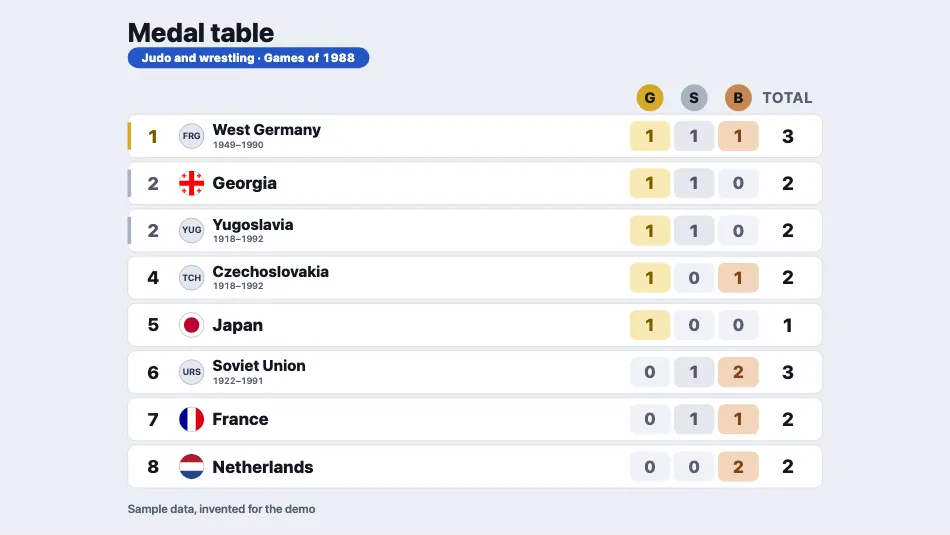
</picture>
</p>
`medalTable` ranks countries or teams gold first or by the total, equal rows sharing a rank, with a flag or a badge for each; `tallyMedals` adds up a list of medals and `medalRanks` gives the ranks as data. [docs/medals.md](./docs/medals.md) · [try it in the demo](https://johnmorrisdotca.github.io/taisen-brackets/#medals)

<p align="center"><picture>
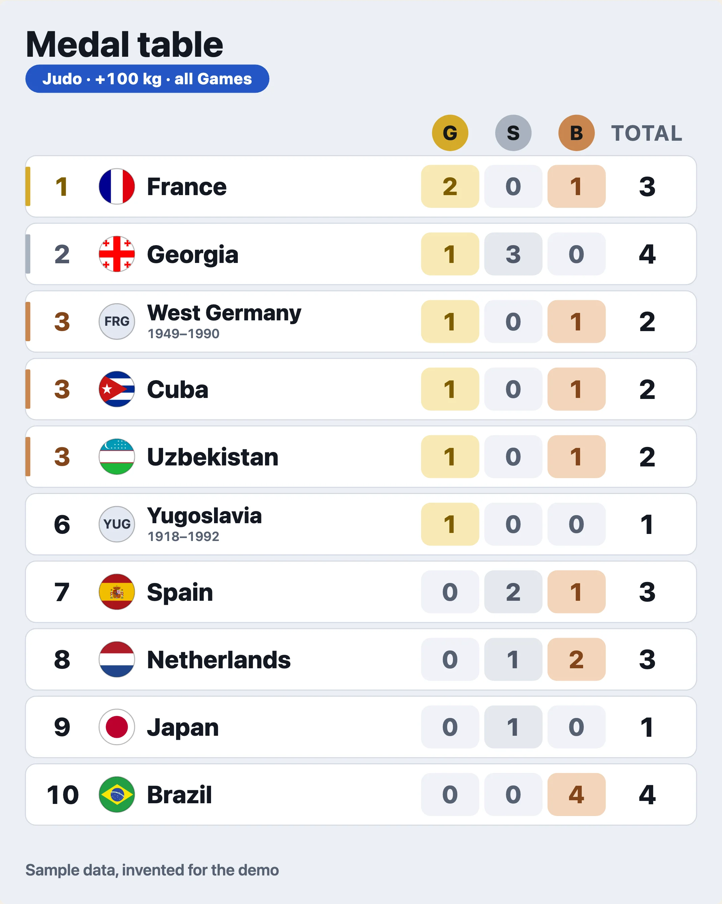
</picture><br><em>A made-up medal table (invented results).</em></p>

### The road look, and the road to the final

`look: "road"` draws the bracket with large round flags, big bold scores and a team's path as a dotted line, and `roadToFinal` draws the way each finalist came from the same tournament.

<table>
<tr>
<td align="center" valign="top">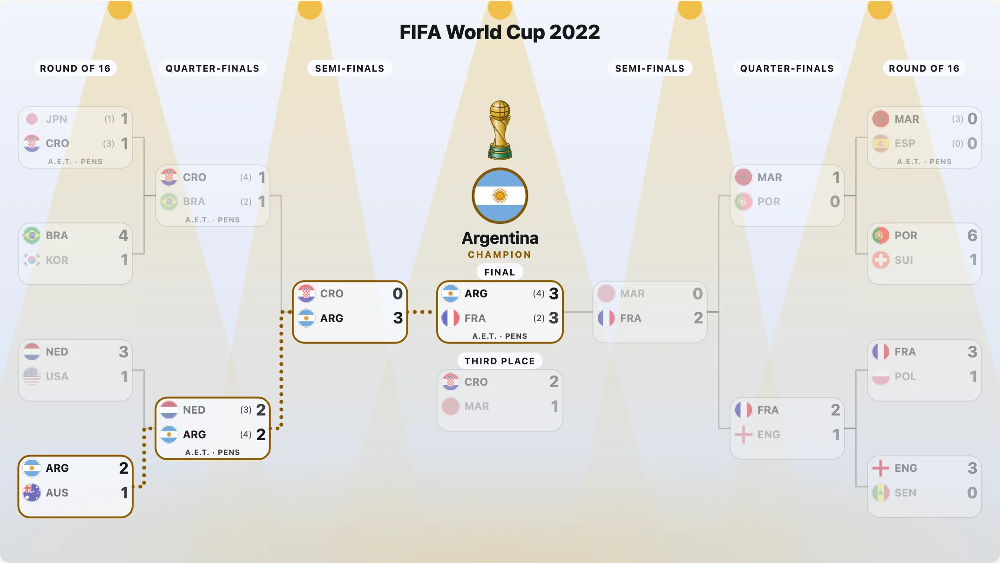<br><em>The road look, wide, with Argentina's path.</em></td>
<td align="center" valign="top">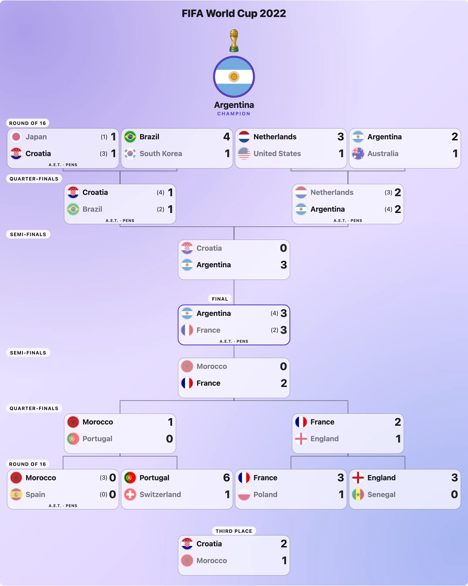<br><em>A card, 1080 by 1350.</em></td>
<td align="center" valign="top">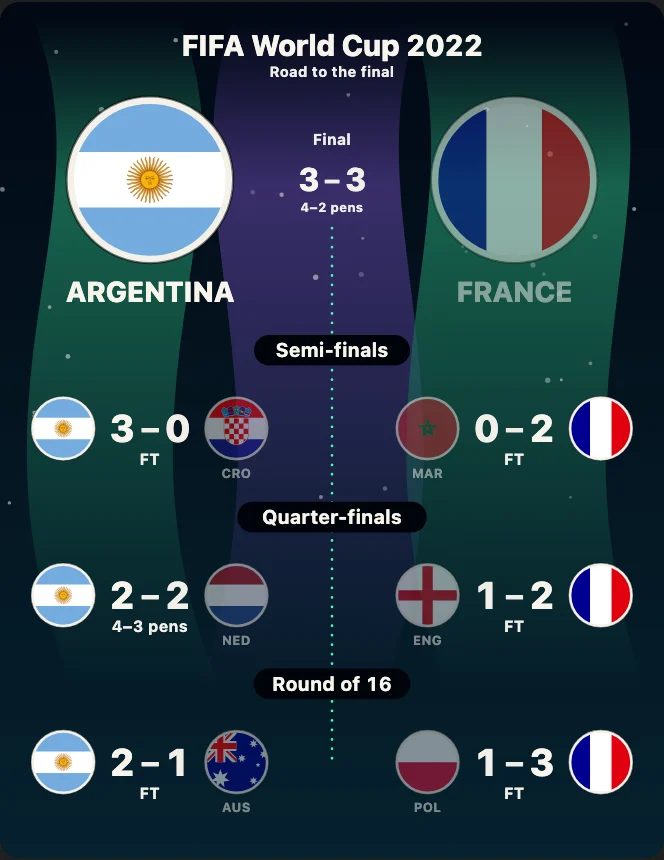<br><em>The road to the final, on a phone.</em></td>
</tr>
<tr>
<td align="center" valign="top">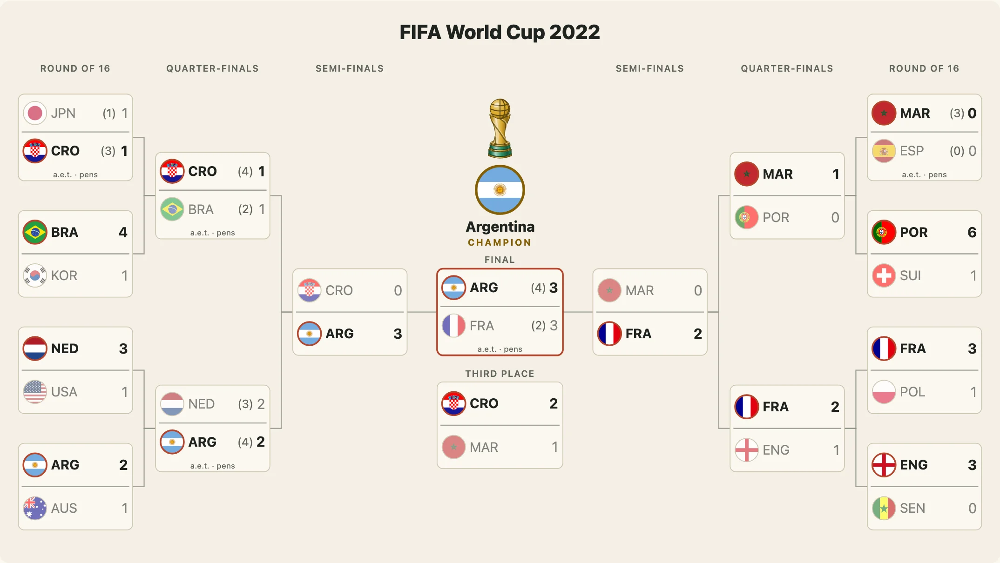<br><em>The classic look, still the default.</em></td>
<td align="center" valign="top">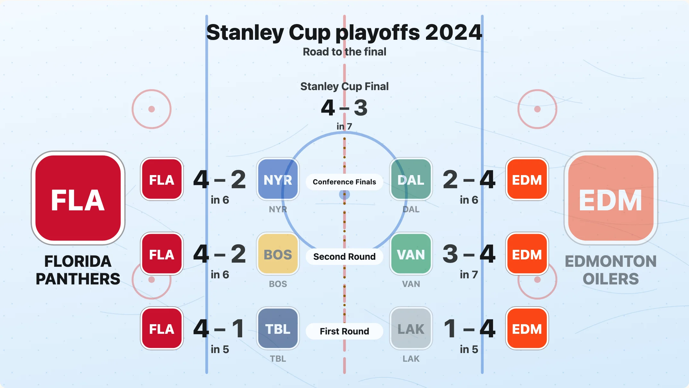<br><em>The road to the final, a play-off (NHL 2024).</em></td>
<td align="center" valign="top">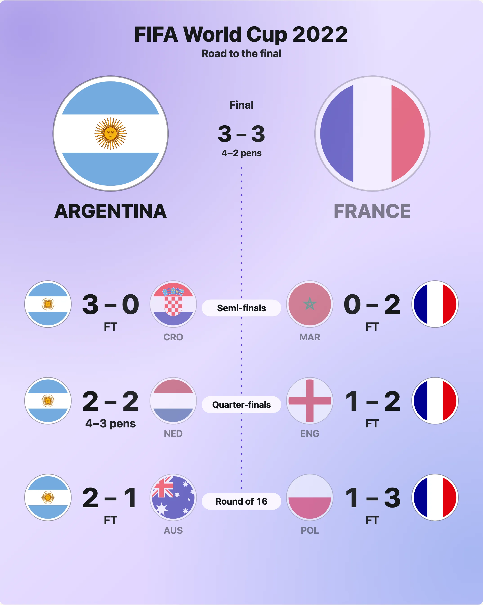<br><em>The road to the final, a card.</em></td>
</tr>
</table>

### Every size and look

Wide, square, a card for a post and a tall one for a phone, in light, dark or a gold-on-navy poster look; [Every sport](./docs/every-sport.md) has the same bracket drawn for the NHL, NBA, MLB, NFL, CFL, MLS and the World Cup.

<table align="center">
<tr>
<td align="center" valign="top">
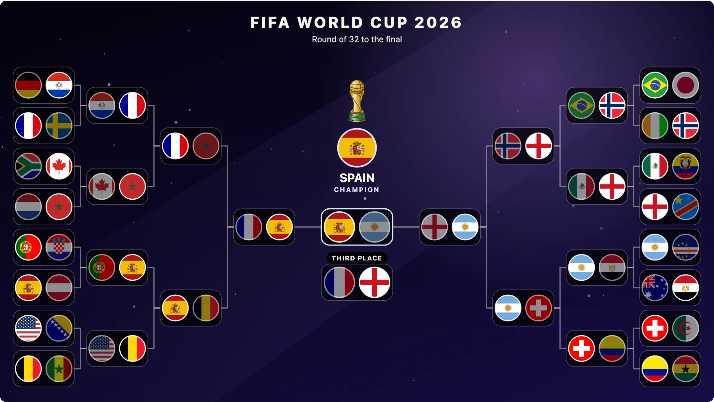<br><em>The poster look: flags only, gold on navy (the 2026 World Cup).</em>
</td>
<td align="center" valign="top">
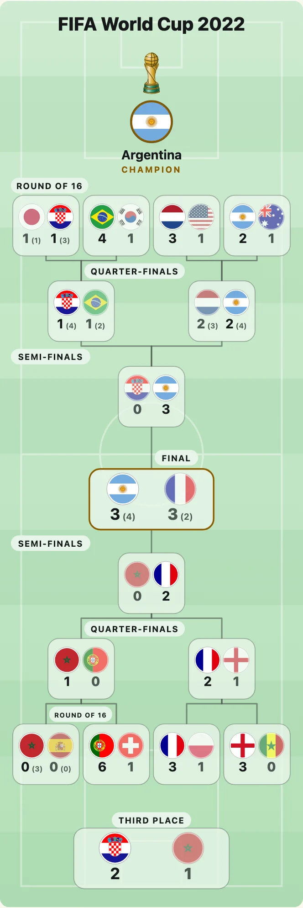<br><em>On a phone the rounds are rows.</em>
</td>
</tr>
</table>

## Layouts

`layout` draws the same ties another way: the default, `"tree"`, is the bracket above; the others are `"rows"`, `"shields"`, `"update"`, `"columns"`, `"playin"`, `"series"`, `"groups"` and `"picture"` (the postseason picture: logo tiles with their seeds, the result beside each pair, the length of each series under its column). Each takes the `background`, both looks, the four sizes, the five languages, `href` links, seeds, codes, flags and logos, and a team with no picture is its tile. [docs/layouts.md](./docs/layouts.md) has the options and what each needs.

## Backgrounds

`background` draws a poster background under the bracket: a gradient, a glow, a pattern or the markings of a playing surface, all drawn in code, each in a dark and a light variant. The text, the lines, the boxes and the marks take the colours that read over it. The plain colour stays the default.

<p align="center">
<picture>
<source media="(prefers-color-scheme: dark)" srcset="https://raw.githubusercontent.com/johnmorrisdotca/taisen-brackets/main/docs/images/backgrounds-dark.webp">
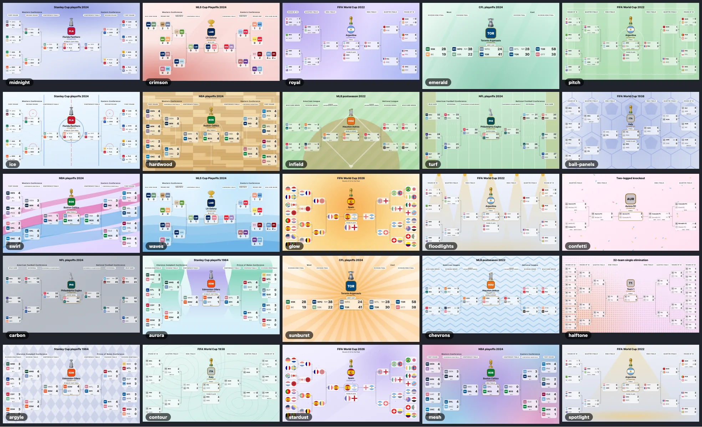
</picture>
</p>

The twenty-five are listed, with what each is for, in [layouts, looks and backgrounds](./docs/guides/layouts-and-looks.md#backgrounds) and [docs/backgrounds.md](./docs/backgrounds.md).

```js
import { drawBracket } from "@johnmorrisdotca/taisen-brackets";

const ties = [
  { sides: ["VAN", "NSH"], score: [4, 3], round: 1, seeds: ["P1", "WC2"] },
  { sides: ["EDM", "LAK"], score: [1, 2], round: 1, seeds: ["P2", "P3"] },
  { sides: ["VAN", "LAK"], score: [2, 1], round: 2 },
];

// A preset by name; with `theme: "auto"` (the default) both variants are drawn and the page's own light or dark shows the right one.
const ice = drawBracket(ties, { look: "road", background: "ice", seeds: true });

// A preset, tuned: your own colours, the angle, how strong the pattern is, a seed for the scattered parts.
const mine = drawBracket(ties, { look: "road", theme: "dark", background: { preset: "swirl", colors: ["#10203a", "#3a1060", "#ff7ac8", "#6ae0ff"], angle: 135, intensity: 0.8 } });

// Your own picture, under a veil (http(s), relative or data:image/ only).
const photo = drawBracket(ties, { look: "road", theme: "dark", background: { image: "stadium.jpg", fit: "cover", dim: 0.55 } });

console.log(ice.includes("tb-bgd"), mine.includes("#ff7ac8"), photo.includes('<image href="stadium.jpg"')); // true true true
```

In the road look, `seeds: true` writes a small tag (`P1`, `WC2`) beside each team's mark, `codes: true` its three letters under the mark in a box of marks, `vs: true` a "v" between the two marks, and a team with no flag or logo is a tile with its letters. [docs/backgrounds.md](./docs/backgrounds.md) has the options, the contrast rules and the module the other packages of the family share.

## In 30 seconds

```sh
npm install @johnmorrisdotca/taisen-brackets
```

```js
import { drawBracket } from "@johnmorrisdotca/taisen-brackets";

const svg = drawBracket([
  { sides: ["Aurora", "Harbour"], score: [2, 1], date: "2026-06-01" },
  { sides: ["Cascade", "Delta"], score: [0, 1], date: "2026-06-01" },
  { sides: ["Aurora", "Delta"], score: [3, 3], extraTime: true, pens: [4, 2], date: "2026-06-08" },
]);

console.log(svg.startsWith("<svg")); // true
```

Put the string in a page (`element.innerHTML = svg`), write it to a file, or send it from a server: it is plain SVG, with no script and no network. A tie names its two sides and, when it has been played, its score; which tie feeds which, the rounds, the halves and the champion are worked out from who plays whom.

## Who it is for

- **Sports sites** that show a playoff or a World Cup from the results they already hold, on a server or in the browser.
- **Anyone with a poster or a social card to make**: the same data draws a wide, a square or a phone-shaped bracket, in a gold-on-navy look, with round flags.
- **Tournament organisers** who need a bracket for any number of teams, with byes, that fills in as the games are played.
- **Readers who need more than a picture**: every drawing has a title and a description, and `bracketTable` writes the same bracket as a plain HTML table.

## Features

- **Ties of every kind**: a single game (with extra time and a shoot-out), a best-of-N series (by games, or by games won), two or more legs added up, and a drawn game replayed. The winner is worked out from the games, or named.
- **The layout is worked out**: rounds (from who plays whom, or given), which tie feeds which, two halves meeting at the final (named for the conferences when the groups split them cleanly) or one tree left to right, byes, seeds, a third-place match placed apart, and ties that lead nowhere drawn below.
- **A bracket that is not played yet**: name the tree with `feeds`, or let `singleElimination` build it for any number of teams, seeded in the standard way, with byes; `advanceWinners` carries results forward.
- **Wide, square, card, phone**: 1200 by 675, 1080 by 1080, 1080 by 1350 (a tall post), or 390 wide and as tall as it needs; the rounds are columns, or rows on a phone and a card. Boxes show names and scores, abbreviations, or only the marks, whichever fits.
- **The road look**: `look: "road"` draws large round flags or crests, big bold scores with the loser's quiet, the rounds named on pills, and, for one team, its path through the bracket as a dotted line. It is the look of the road-to-the-final chart below, and every other option works with it.
- **The road to the final**: `roadToFinal` draws the two finalists of the tournament you already have, with the ties each played on the way and the score between their flags, on a card, a square, wide or a phone.
- **Poster backgrounds**: twenty-five, drawn in code, each in a dark and a light variant, among them the playing surfaces of hockey, basketball, baseball, football and soccer; your own colours, or your own picture; and the text, lines and boxes take the colours that read over them (4.5 to 1, held by a test).
- **Seed tags, codes and a "vs"** in the road look, and a team with no picture drawn as a tile with its letters, so that nothing looks missing.
- **Nine layouts**: `layout` draws the same ties as the tree, as `rows` (a name, a mark and a result slot a team), `shields`, a score-`update` card, tall `columns` in two conference colours, the NBA's `playin` with winners' and losers' arrows, a `series` card, the `groups` tables, or the postseason `picture` (two halves mirrored toward the final, each club a logo tile with its seed, "CLE wins 3–2" beside each pair, "Best of 5" under each round, the champion big in the middle); with big conference `headers` over each half in any of them, a lone final centred, and one stylesheet for several drawings (`styleScope`, `style: false`).
- **Nothing sticks out**: marks, text and round names stay inside their boxes and off the connector lines, in every size and both looks, held by a geometry test.
- **A link on every box**: `href: (tie, side?) => address` makes each tie's box (or each team's row) a real `<a>` in the SVG with an accessible name.
- **Flags from a plug-in**: a team's `flag` code is drawn by the `flags` function you pass (Hata's round flags are one line), with no dependency added.
- **Light, dark, poster**: every colour is a CSS custom property with a fallback, so the drawing follows the page's `prefers-color-scheme` or `data-theme` and can be restyled from outside.
- **Team marks you supply**: a logo address or inline SVG, drawn round or square; a team with none is its initials on a colour. Round flags from [Hata](https://github.com/johnmorrisdotca/hata) go in as they are.
- **The champion in the centre**, with a slot for your trophy: your own SVG or image, or an emblem from [Dougu Sports](https://github.com/johnmorrisdotca/dougu-sports) (a hockey cup, a basketball trophy, a globe) through an optional plug-in, with no dependency added.
- **Accessible**: `role="img"` with a title and a description, a tooltip sentence on every tie, and `bracketTable`.
- **Judo**: `Matchup.judo` takes ippon, waza-ari, yuko, shido, golden score and the contest time, checked against the IJF rules; `judoBracket` adds the repechage and two bronze medal contests, `judoScoreboard` draws one contest as a board or as flip cards, `judoContestCard` and `judoMatQueue` are the screens for the hall, and `judoWins` and `judoRoadPanel` an athlete's road ([docs/judo.md](./docs/judo.md)).
- **Rankings and medals**: `rankingList` draws a ranking from your data, text first, with flags, clubs, points and movement; `rankingNumberOnes`, `rankingEntryList` and `rankingMatchup` draw cards; `medalTable` ranks countries gold first or by the total, with shared ranks and `tallyMedals` to add medals up ([rankings](./docs/rankings.md), [medals](./docs/medals.md)).
- **Broadcast boards**: `resultsBoard`, `boutBoard` and `broadcastMedalTable`, each a standalone SVG to place over a picture, in three looks and with no mark of any games ([docs/broadcast.md](./docs/broadcast.md)).
- **Formats by era**: NHL, NBA, MLB, NFL, CFL, MLS and FIFA World Cup round names, series lengths and byes.
- **Five languages**: English, French, Japanese, Spanish and German, for every word the drawing, the tooltips, the description and the table write, with the football terms of each language; countries named by `Intl` from their ISO code; numbers and dates by `Intl`. Add a language of your own.
- **Deterministic**: no clock, no random number, no counter; the same input gives the same string, and ids come from a hash of the input.
- **No dependencies**, ESM with types, about 140 kB packed.

## Every way to use it

The [demo](https://johnmorrisdotca.github.io/taisen-brackets/), the [docs](https://johnmorrisdotca.github.io/taisen-brackets/docs/) (English and Japanese) and the [embed page](https://johnmorrisdotca.github.io/taisen-brackets/embed.html). Each way below is a tested file in [`examples/`](./examples) (`pnpm test:usage`).

Guides: [script tag](./docs/guides/html-and-cdn.md), [Vite and webpack](./docs/guides/bundlers.md), [React, Vue, Svelte, Angular](./docs/guides/frameworks.md), [iframe](./docs/guides/embed-in-an-iframe.md), [TypeScript and Node](./docs/guides/typescript-and-node.md).

## Guides

Eighteen guides, each with a Japanese twin in [`docs/guides/ja/`](./docs/guides/ja/), written for someone using the package and published as the [documentation site](https://johnmorrisdotca.github.io/taisen-brackets/docs/) with the reference for every export. Every example is run against the built package, and `pnpm docs:check` holds the guides, the reference and the examples together. The ways in (a script tag, Vite and webpack, React, Vue, Svelte, Angular, an iframe, TypeScript and Node) are under "Every way to use it" above; the rest are here.

| Guide | What it is for |
| --- | --- |
| [Getting started](./docs/guides/getting-started.md) | A bracket from a list of games, a size and a look, and a table for the reader the picture does not serve. |
| [Ties and results](./docs/guides/ties-and-results.md) | A game, a series, two legs, a replay, a shoot-out; a flat list of games; reading a result yourself. |
| [A bracket for any number of teams](./docs/guides/any-number-of-teams.md) | `singleElimination`, seeds and byes, carrying results forward, naming the tree yourself. |
| [Layouts, looks and backgrounds](./docs/guides/layouts-and-looks.md) | Size and shape, theme, the road look, nine layouts and twenty-five backgrounds. |
| [Formats by era](./docs/guides/formats-by-era.md) | The NHL, NBA, MLB, NFL, CFL, MLS and World Cup rounds of any season. |
| [Marks, flags, the champion and its trophy](./docs/guides/marks-flags-and-trophies.md) | Your marks, safe by construction; flags and emblems as plug-ins; links on boxes. |
| [The road to the final](./docs/guides/road-to-the-final.md) | The two finalists and the way each came, from a tournament or from two paths. |
| [Languages and accessibility](./docs/guides/languages-and-accessibility.md) | Five languages and your own; what a screen reader gets. |
| [Judo, rankings, medals and boards](./docs/guides/judo-rankings-and-boards.md) | The other graphics around a tournament. |
| [Architecture](./docs/guides/architecture.md) | The pipeline and the four rules, and the checks that keep them true. |
| [Troubleshooting](./docs/guides/troubleshooting.md) | The tree is wrong, a score is the wrong way round, a flag does not appear. |
| [Upgrading](./docs/guides/upgrading.md) | How to check an upgrade, stored drawings, and what each release changed. |

## Use it in your project

### Install

```sh
npm install @johnmorrisdotca/taisen-brackets
# or: pnpm add @johnmorrisdotca/taisen-brackets
# or: yarn add @johnmorrisdotca/taisen-brackets
```

It is ESM, and `require` works on Node 22.12 and later. It needs no DOM: the functions return strings. Five entry points: `@johnmorrisdotca/taisen-brackets` (everything), `/layout` (the layout and the helpers, no drawing), `/presets` (the formats), `/road` (the road to the final) and `/backgrounds` (the twenty-five backgrounds on their own).

## Examples

### A bracket from its ties

A matchup is two `sides` (a team's id, or a whole team) and, once played, the result. Teams can be listed once, with names, marks and groups; a side named by an id that is not listed is a team of that name.

```js
import { drawBracket, layoutBracket } from "@johnmorrisdotca/taisen-brackets";

const teams = [
  { id: "NED", name: "Netherlands" }, { id: "ARG", name: "Argentina" },
  { id: "CRO", name: "Croatia" }, { id: "BRA", name: "Brazil" },
];
const matchups = [
  { sides: ["NED", "ARG"], score: [2, 2], extraTime: true, pens: [3, 4], date: "2022-12-09" },
  { sides: ["CRO", "BRA"], score: [1, 1], extraTime: true, pens: [4, 2], date: "2022-12-09" },
  { sides: ["ARG", "CRO"], score: [3, 0], date: "2022-12-13" },
];

const layout = layoutBracket({ matchups, teams });
console.log(layout.rounds);        // 2
console.log(layout.champion.name); // Argentina
console.log(layout.shape);         // halves

const svg = drawBracket(layout, { title: "Semi-finals and final" });
```

`layoutBracket` is the sport-agnostic part: it gives the rounds, the halves, the rows, and for each tie its result. `drawBracket` takes the same input, or a layout you already have.

### A playoff series, and a format by era

A series is `bestOf` and the games won; or give the games and it counts them. `playoffFormat(league, season)` has the league's round names for the era, and the halves take the conferences' names when the teams' `group` splits them.

```js
import { drawBracket, playoffFormat } from "@johnmorrisdotca/taisen-brackets";

const format = playoffFormat("nhl", 2024);
console.log(format.rounds.map((round) => round.name).join(", ")); // First Round, Second Round, Conference Finals, Stanley Cup Final

const svg = drawBracket(
  {
    teams: [
      { id: "FLA", name: "Florida Panthers", abbr: "FLA", group: "Eastern" }, { id: "BOS", name: "Boston Bruins", abbr: "BOS", group: "Eastern" },
      { id: "EDM", name: "Edmonton Oilers", abbr: "EDM", group: "Western" }, { id: "DAL", name: "Dallas Stars", abbr: "DAL", group: "Western" },
    ],
    matchups: [
      { sides: ["FLA", "BOS"], bestOf: 7, score: [4, 2], date: "2024-05-06" },
      { sides: ["DAL", "EDM"], bestOf: 7, score: [2, 4], date: "2024-05-23" },
      { sides: ["FLA", "EDM"], bestOf: 7, score: [4, 3], date: "2024-06-08" },
    ],
  },
  { roundNames: format, title: "Stanley Cup playoffs 2024" },
);
console.log(svg.includes("Eastern")); // true
```

### Two legs, replays, a shoot-out

```js
import { layoutBracket } from "@johnmorrisdotca/taisen-brackets";

const layout = layoutBracket([
  { id: "a", sides: ["Aurora", "Harbour"], kind: "aggregate", legs: [{ score: [2, 0] }, { score: [0, 1] }] },
  { id: "b", sides: ["Cascade", "Delta"], games: [{ score: [1, 1] }, { score: [2, 0], replay: true }] },
  { id: "c", sides: ["Aurora", "Cascade"], score: [1, 1], extraTime: true, pens: [3, 5] },
]);

for (const tie of layout.ties) console.log(tie.result.kind, tie.result.score.join("-"), tie.sides[tie.winner].name);
// aggregate 2-1 Aurora
// replay 2-0 Cascade
// game 1-1 Cascade
```

A drawn game that was replayed is one tie, decided by the replay (the 1934 and 1938 World Cups). Level on aggregate, a shoot-out settles it, or name the `winner` yourself (away goals, a coin toss) and add a `note`.

### Byes, seeds, and a bracket for any number of teams

```js
import { advanceWinners, drawBracket, singleElimination } from "@johnmorrisdotca/taisen-brackets";

const teams = Array.from({ length: 6 }, (_, i) => ({ id: `T${i + 1}`, name: `Team ${i + 1}` }));
const { matchups } = singleElimination(teams, { thirdPlace: true });
// Two first-round ties (R1-2 and R1-4: the top two seeds have byes), two semi-finals, the final and the third-place match.
console.log(matchups.length); // 6

// Results as they come in, by the tie's id; the sides of later ties fill in from the winners.
const played = matchups.map((m) => (m.id === "R1-2" ? { ...m, score: [2, 1] } : m));
const next = advanceWinners(played);
console.log(next.find((m) => m.id === "R2-1").sides); // [ 'T1', 'T4' ]

const svg = drawBracket({ teams, matchups: next }, { seeds: true });
```

The top seeds skip the first round; the layout knows which side of a tie had the bye (`box.bye`), and a drawing with no result yet shows "TBD" where a side is not known.

### From a flat list of games

Most data sources give a flat list of games. `matchupsFromGames` groups them into ties by stage and pair: several games of one pair in a stage are a replay, unless the stage is two-legged (`aggregate`) or a series (`series`).

```js
import { drawBracket, matchupsFromGames } from "@johnmorrisdotca/taisen-brackets";

const matchups = matchupsFromGames(
  [
    { stage: "semi", home: "ARG", away: "CRO", homeScore: 3, awayScore: 0, date: "2022-12-13" },
    { stage: "semi", home: "FRA", away: "MAR", homeScore: 2, awayScore: 0, date: "2022-12-14" },
    { stage: "third", home: "CRO", away: "MAR", homeScore: 2, awayScore: 1, date: "2022-12-17" },
    { stage: "final", home: "ARG", away: "FRA", homeScore: 3, awayScore: 3, extraTime: true, homePens: 4, awayPens: 2, date: "2022-12-18" },
  ],
  { stages: ["semi", "final"], third: "third" },
);
console.log(matchups.length); // 4
const svg = drawBracket(matchups);
```

### Sizes, shapes and looks

```js
import { drawBracket } from "@johnmorrisdotca/taisen-brackets";

const bracket = [
  { sides: ["A", "B"], score: [1, 0], date: "1" }, { sides: ["C", "D"], score: [0, 2], date: "1" }, { sides: ["A", "D"], score: [2, 1], date: "2" },
];

drawBracket(bracket);                                   // wide: 1200 by 675
drawBracket(bracket, { size: "square" });               // 1080 by 1080
drawBracket(bracket, { size: "card" });                 // 1080 by 1350, a tall post, the rounds as rows
drawBracket(bracket, { size: "phone" });                // 390 wide, the rounds as rows
drawBracket(bracket, { size: { width: 800, height: 500 } });
drawBracket(bracket, { shape: "ltr" });                 // one tree, left to right, the champion at the end
drawBracket(bracket, { theme: "dark" });                // "auto" (the default) follows the page, "light", "dark", "poster"
drawBracket(bracket, { theme: "poster", detail: "mark", roundLabels: false, title: "Knockout stage" });
drawBracket(bracket, { background: false });            // transparent
drawBracket(bracket, { theme: "none" });                // no <style>: your CSS draws it, currentColor is the fallback
```

`detail` is `full` (names and scores), `compact` (abbreviations), `mark` (only the marks) or `auto`, which takes the fullest one that fits the box and the longest name.

### The road look, and the path of a team

`look: "road"` draws the bracket the way the road-to-the-final chart is drawn: large round marks with a wide ring, big bold scores in which the loser's is quiet, the rounds named on pills, and boxes as high as their width lets the marks be. A box that cannot hold names is its abbreviations, and one that cannot hold even those is two marks with each score under its mark. The classic look stays the default, and every option works in both looks. `highlightPath` takes a team's id and draws that team's way to the final as a dotted line, with the other ties quieter.

```js
import { drawBracket } from "@johnmorrisdotca/taisen-brackets";

const bracket = [
  { sides: ["A", "B"], score: [1, 0], date: "1" }, { sides: ["C", "D"], score: [0, 2], date: "1" }, { sides: ["A", "D"], score: [2, 1], date: "2" },
];

const svg = drawBracket(bracket, { look: "road", size: "card", highlightPath: "A" });
console.log(svg.includes("tb-look-road"));                     // true
console.log(svg.includes('viewBox="0 0 1080 1350"'));          // true
console.log((svg.match(/class="tb-line tb-path"/g) ?? []).length); // 1
```

A team that lost on the way has a path that ends where it lost, and the third-place match is never on a path. Colours are custom properties: `--tb-mark-ring`, `--tb-mark-edge`, `--tb-panel` and `--tb-spine` are the road look's own, over the ones in Theming.

### A link on every box

`href: (tie, side?) => address` makes each tie's box (or each team's row) a real `<a>` in the SVG with an accessible name, a hover and a focus ring; an address must be http(s), relative or a `#` fragment. [A link on every box](./docs/guides/marks-flags-and-trophies.md#a-link-on-every-box).

### Team marks, and round flags

A team's `mark` is an image address or inline SVG, drawn in a circle, a square or not at all; a team with none is its initials on its colour, and a `flag` code is drawn by a `flags` function you pass (Hata's round flags are one line). Inline SVG is cleaned as it goes in. [Marks, flags and trophies](./docs/guides/marks-flags-and-trophies.md) has the code.

### The champion, and a trophy

Once the final is played the champion is in the centre; pass your own `trophy` (inline SVG or an address) or an emblem id such as `"trophy:hockey-cup"` with an `emblems` renderer. [Marks, flags and trophies](./docs/guides/marks-flags-and-trophies.md#the-champion-and-a-trophy).

### Emblems for the trophy

`emblems` is any function from an id and a request to an SVG string; `renderEmblem` from [Dougu Sports](https://github.com/johnmorrisdotca/dougu-sports) is one, and `LEAGUE_EMBLEMS` names each league's default. Without a renderer an emblem id draws nothing and takes no room. [The rest](./docs/guides/marks-flags-and-trophies.md#an-emblem-from-dougu-sports).

### Flags from a plug-in

A team's `flag` code is drawn by the `flags` function you pass: any synchronous function from a code and a request (`{ shape, size, theme }`) to an SVG string. Each flag is written once, as a `<symbol>`, and without a renderer the mark or the initials are drawn. [Flags from a plug-in](./docs/guides/marks-flags-and-trophies.md#flags-from-a-plug-in).

### The road to the final

`roadToFinal` draws the two finalists of a tournament and the way each came: two large round marks, the rounds down the middle, each finalist's matches on its side with the score between the teams' marks. It takes what `drawBracket` takes, or two paths you write, and gives back `{ options, title, summary, totals, draw(extra?), table(options?) }`. [The road to the final](./docs/guides/road-to-the-final.md) has both ways in code; [docs/road.md](./docs/road.md) the fields and options.

### A table for readers the picture does not serve

```js
import { bracketTable, describeBracket } from "@johnmorrisdotca/taisen-brackets";

const bracket = [{ sides: ["Aurora", "Harbour"], score: [2, 1] }];
console.log(describeBracket(bracket)); // 2 teams, 1 round. Final: Aurora 2, Harbour 1. Winner: Aurora. Champion: Aurora.
console.log(bracketTable(bracket).startsWith("<table")); // true
```

`bracketTable` writes a plain `<table>` with a caption and header cells, a row for each tie, the winner in bold, and the note ("a.e.t.", "pens 4–2", "agg.", "in 7").

### Your own words

Every word the package writes is in `WORDS` (English; see Languages for the others); pass `words` to replace any: `{ champion: "Vainqueur", thirdPlace: "Match pour la 3e place", tbd: "À déterminer" }`. Round names come from `roundNames`: a list, or a format from `playoffFormat`.

### From a CDN, as a module

```html
<div id="bracket"></div>
<script type="module">
  import { drawBracket } from "https://cdn.jsdelivr.net/npm/@johnmorrisdotca/taisen-brackets@0/+esm";
  document.querySelector("#bracket").innerHTML = drawBracket([{ sides: ["Aurora", "Harbour"], score: [2, 1] }]);
</script>
```

### In TypeScript

```ts
import { drawBracket, type DrawOptions, type Matchup } from "@johnmorrisdotca/taisen-brackets";

const ties: Matchup[] = [{ sides: ["Aurora", "Harbour"], score: [2, 1] }];
const options: DrawOptions = { size: "square", theme: "dark" };
console.log(drawBracket(ties, options).startsWith("<svg"));
```

### In React, Vue, Svelte and Angular

The functions return strings, so any framework can use them. The string is built from your data with every name escaped; do not put untrusted SVG in `mark` or `trophy` without knowing that it is cleaned (it is) and that an image address you pass is loaded by the visitor's browser.

```tsx no-check
// React
<div dangerouslySetInnerHTML={{ __html: drawBracket(bracket, { size: "phone" }) }} />
```

```vue
<!-- Vue -->
<template><div v-html="svg" /></template>
<script setup>
import { computed } from "vue";
import { drawBracket } from "@johnmorrisdotca/taisen-brackets";
const props = defineProps({ ties: Array });
const svg = computed(() => drawBracket(props.ties, { size: "phone" }));
</script>
```

```svelte
<!-- Svelte -->
<script>
  import { drawBracket } from "@johnmorrisdotca/taisen-brackets";
  export let ties = [];
  $: svg = drawBracket(ties, { size: "phone" });
</script>
{@html svg}
```

```ts no-check
// Angular: a component with `svg = drawBracket(this.ties)` and `<div [innerHTML]="svg"></div>`; the string is the package's own, so it is safe to trust.
import { Component, Input } from "@angular/core";
import { drawBracket, type Matchup } from "@johnmorrisdotca/taisen-brackets";

@Component({ selector: "app-bracket", standalone: true, template: `<div [innerHTML]="svg"></div>` })
export class BracketComponent {
  svg = "";
  @Input() set ties(value: Matchup[]) {
    this.svg = drawBracket(value, { size: "phone" });
  }
}
```

### On a server, and as a file

```js no-run
import { createServer } from "node:http";
import { writeFileSync } from "node:fs";
import { drawBracket } from "@johnmorrisdotca/taisen-brackets";

const ties = [{ sides: ["Aurora", "Harbour"], score: [2, 1] }];
// A file that stands alone: open it in a browser, or put it in an image tag.
writeFileSync("bracket.svg", drawBracket(ties, { theme: "light" }));
// Or an image address: the same input gives the same bytes, so a CDN can keep it.
createServer((request, response) => {
  response.writeHead(200, { "content-type": "image/svg+xml", "cache-control": "public, max-age=3600" });
  response.end(drawBracket(ties));
}).listen(7100);
```

### In a frame

```html
<iframe src="https://johnmorrisdotca.github.io/taisen-brackets/" title="A bracket drawn by Taisen Brackets" loading="lazy" style="width:100%;aspect-ratio:16/9;border:0"></iframe>
```

A page that cannot run script can show the demo in a frame; a page that can should draw the string itself, which needs no network.

### Shaping the data

```js
import { collectTeams, drawBracket } from "@johnmorrisdotca/taisen-brackets";

// Ties from your own feed: keep the sides as ids, list the teams once, and the bracket shows their names.
const feed = [
  { home: "NED", away: "ARG", homeGoals: 2, awayGoals: 2 },
  { home: "CRO", away: "BRA", homeGoals: 1, awayGoals: 1 },
];
const ties = feed.map((game) => ({ sides: [game.home, game.away], score: [game.homeGoals, game.awayGoals], extraTime: true, pens: [4, 3] }));
console.log(collectTeams(ties).size, drawBracket({ matchups: ties, teams: [{ id: "NED", name: "Netherlands" }] }).includes("Netherlands")); // 4 true
```

## API

Everything is exported from `@johnmorrisdotca/taisen-brackets`; the layout part from `/layout`, the formats from `/presets`, the road to the final from `/road` and the backgrounds from `/backgrounds`. The [API reference](https://johnmorrisdotca.github.io/taisen-brackets/docs/api/main/) on the documentation site lists every export of every entry point with its signature, doc comment and an example, made from the source; [docs/functions.md](./docs/functions.md) says what each family of functions is for and lists the options of `drawBracket` and `roadToFinal`.

- **Draw**: `drawBracket(input, options?)` (the SVG string; `input` is a list of matchups, `{ matchups, teams }` or a layout), `roadToFinal(input, options?)`, `bracketStyle(options)`, `LAYOUTS`, `CONFERENCE_COLORS`, `groupStandings`, `groupsTable`.
- **Work out**: `layoutBracket(input, options?)`, `bracketTable`, `describeBracket`, `singleElimination`, `advanceWinners`, `standardSeeds`, `matchupsFromGames`, `resolveMatchup`, `collectTeams`, `describeTie`, `noteParts`, `noteLong`.
- **Judo**: `judoOutcome`, `judoBracket`, `judoPodium`, `judoCategoryLabel`, `JUDO_WEIGHT_CLASSES`, `judoSeconds`, `judoClock`, `judoScoreboard`, `describeJudoContest`, `JUDO_BOARD_SIZES`, `judoContestCard`, `judoMatQueue`, `describeJudoCard`, `describeJudoQueue`, `JUDO_MAT_COLORS`, `judoWins`, `judoRoadPanel`, `describeJudoRoad` ([docs/judo.md](./docs/judo.md)).
- **Rankings and medals**: `rankingList`, `rankingRanks`, `rankingCategoryLabel`, `describeRanking`, `BOARD_SIZES`, `rankingNumberOnes`, `describeNumberOnes`, `NUMBER_ONE_COLORS`, `rankingEntryList`, `describeEntryList`, `rankingMatchup`, `describeMatchup`, `matchupRecord`, `medalTable`, `medalRanks`, `tallyMedals`, `describeMedalTable` ([rankings](./docs/rankings.md), [medals](./docs/medals.md)).
- **Broadcast boards**: `resultsBoard`, `resultsBoardSize`, `describeResultsBoard`, `BROADCAST_LOOKS`, `boutBoard`, `boutBoardSize`, `describeBoutBoard`, `broadcastMedalTable`, `broadcastMedalSize` ([docs/broadcast.md](./docs/broadcast.md)).
- **Formats and rounds**: `playoffFormat`, `playoffEras`, `LEAGUES`, `LEAGUE_EMBLEMS`, `roundName`, `roundNamesFor`, `roundLabel`.
- **Languages**: `LOCALES`, `LOCALE_CODES`, `defineLocale`, `localeOf`, `voiceOf`, `countryName`, `localizedLayout`, `WORDS`.
- **Looks and backgrounds**: `SIZES`, `THEMES`, `ROAD_THEMES`, `VERSION`, `BACKGROUND_PRESETS`, `backgroundSvg`, `contrastRatio`, `resolveBackground`, `FAMILY_BACKGROUNDS_VERSION`.
- **Marks and plug-ins**: `cleanSvg`, `safeUrl`, `safeHref`, `abbreviate`, `isEmblemId`, and the types `EmblemRenderer`, `EmblemRequest`, `EmblemStyle`, `FlagRenderer`, `FlagRequest`, `FlagShape` ([marks, flags and trophies](./docs/guides/marks-flags-and-trophies.md)).


## Languages

A World Cup is read in many languages, so every text the package writes (the round names, the notes, the champion's label, the table's headers, the accessible description, the numbers and the dates) has a table of words in English, French, Japanese, Spanish and German. Pass `locale`:

```js
import { countryName, describeBracket } from "@johnmorrisdotca/taisen-brackets";

const teams = [{ id: "ARG", name: "Argentina", region: "AR" }, { id: "FRA", name: "France", region: "FR" }];
const matchups = [{ sides: ["ARG", "FRA"], score: [3, 3], extraTime: true, pens: [4, 2], date: "2022-12-18" }];
// A country's name in the language comes from Intl, by its ISO code: no list of names to write.
const teamName = (team, locale) => team.region && countryName(team.region, locale);

for (const locale of ["en", "fr", "ja", "es", "de"]) console.log(describeBracket({ matchups, teams }, { locale, teamName }));
// 2 teams, 1 round. Final: Argentina 3, France 3 (after extra time, 4–2 on penalties). Winner: Argentina. Champion: Argentina.
// 2 équipes, 1 tour. Finale : Argentine 3, France 3 (après prolongation, 4–2 aux tirs au but). Vainqueur : Argentine. Champion : Argentine.
// 2チーム、1ラウンド。決勝：アルゼンチン 3–3 フランス（延長戦、PK戦 4–2）。勝者：アルゼンチン。優勝：アルゼンチン。
// 2 equipos, 1 ronda. Final: Argentina 3, Francia 3 (tras la prórroga, 4–2 en los penales). Ganador: Argentina. Campeón: Argentina.
// 2 Teams, 1 Runde. Finale: Argentinien 3, Frankreich 3 (nach Verlängerung, 4:2 im Elfmeterschießen). Sieger: Argentinien. Turniersieger: Argentinien.
```

<p align="center">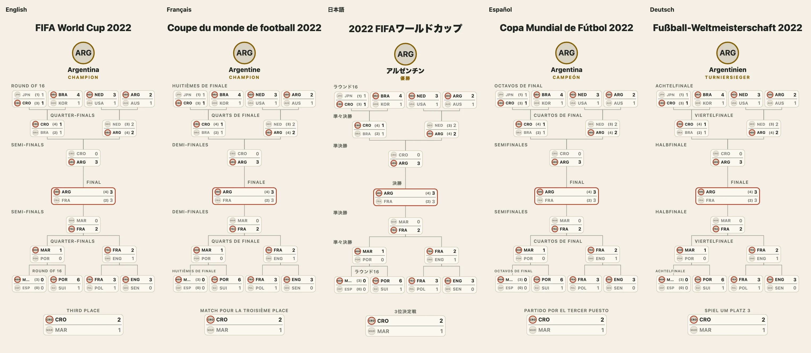</p>

- `locale` is `"en"` (the default), `"fr"`, `"ja"`, `"es"`, `"de"`, or a `Locale` you made with `defineLocale`. It sets the words, the names of the rounds, the `lang` of the `<svg>` and of the `<table>`, the digits and the dates (`Intl`), and capitals by the language's rules (not for Japanese).
- Team names come from a team's `names`, the option `teamName(team, locale)` or `countryName("DE", locale)`; `words` replaces any string of any language; `defineLocale("nl", { words: { champion: "Kampioen" } })` fills what you leave out from English. [Languages and accessibility](./docs/guides/languages-and-accessibility.md) has each.

```js
import { defineLocale, drawBracket } from "@johnmorrisdotca/taisen-brackets";

const dutch = defineLocale("nl", { words: { champion: "Kampioen" }, rounds: { Final: "Finale" } });
const svg = drawBracket([{ sides: ["A", "B"], score: [2, 1] }], { locale: dutch });
console.log(svg.includes("KAMPIOEN")); // true
console.log(svg.includes('lang="nl"')); // true
```

## Sports covered

`playoffFormat(league, year)` gives the round names, the length of each series, the number of teams and the byes; [docs/formats.md](./docs/formats.md) lists the eras.

| League | Covered | Rounds in the latest era |
| --- | --- | --- |
| NHL | 1975 on (no playoffs in 2005), with 1980–81, 1982–86, 1987–93, 1994–2013, 2014 on, 2020 and 2021 as their own eras | First Round, Second Round, Conference Finals, Stanley Cup Final |
| NBA | 1977 on | First Round, Conference Semifinals, Conference Finals, NBA Finals |
| MLB | 1969 on (no postseason in 1994) | Wild Card Series, Division Series, League Championship Series, World Series |
| NFL | 1970 on, with 1982 as its own | Wild Card, Divisional, Conference Championship, Super Bowl |
| CFL | 1996 on | Division Semi-Final, Division Final, Grey Cup |
| MLS | 2023 on | Wild Card Round, Round One (best of three), Conference Semifinals, Conference Finals, MLS Cup |
| FIFA World Cup | every edition with a knockout, 1930 to 2026 (1950 had none) | Round of 32 (2026), Round of 16, Quarter-finals, Semi-finals, Final |
| Judo (IJF rules of 21 January 2026) | any weight category: `judoBracket` with the quarter-final repechage or a direct knockout | Round of N … Final, repechage, two bronze medal contests |
| Any other | single elimination for any number of teams | Round of N … Final |

Each era was checked against English Wikipedia (facts only; the articles are cited in [docs/formats.md](./docs/formats.md)). The year is the year the playoffs are played in, except for the NFL, whose year is its season's, so 2024 is the season whose playoffs were played in January and February 2025. A season did something of its own (a strike, a pandemic) has its own entry, and a later one is not covered until it is checked.

## Theming

Every colour is `var(--tb-<name>, <the look's value>)`, so a page restyles a drawing without touching it:

```css
.my-bracket { --tb-ink: #123; --tb-win: #c60; --tb-box: #fff; --tb-line: #99a; }
```

The names are `bg`, `ink`, `muted`, `line`, `box`, `edge`, `win`, `gold`, `plain` and `font`. `theme: "auto"` is the light look and, under `prefers-color-scheme: dark` or `<html data-theme="dark">`, the dark one (`data-theme="light"` keeps it light). See [docs/drawing.md](./docs/drawing.md).

## Limits

- A bracket is a tree: every tie feeds one tie. Double elimination is not drawn. A loser can go on to another tie (`feeds: [{ tie, result: "loser" }]`), but only the play-in layout draws that edge; round-robin games (`round: 0`) are drawn as group tables by the `groups` layout, and below the tree by the others.
- Text is measured by an estimate from character classes, not a font file, so that the string is the same on every machine; a long name is cut with an ellipsis a few percent early or late.
- A series with no `bestOf` and no winner is not decided, whatever the games won say.
- On a phone the champion is at the top and the third-place match at the foot; in a wide bracket of two halves they are in the centre.
- The built-in languages are English, French, Japanese, Spanish and German; the Spanish and German words were checked against Wikipedia only and need a native reader (docs/languages.md). A club or a person is not translated, and a team's short name is the same in every language.

## Accessibility

The `<svg>` is `role="img"`, labelled by a `<title>` and a `<desc>` that says how many teams and rounds, the final and the champion; each tie has a tooltip sentence ("Argentina 3, France 3 (a.e.t., pens 4-2). Winner: Argentina"); the winner is marked by weight and a ring, not by colour alone; text is at least 8 units. For the full bracket in a reader's own order, put `bracketTable` beside the picture. The contrast of the light and dark looks' text on their boxes is held to WCAG AA by a test.

## Browser and runtime support

Any current browser, and Node 22 or later. The package makes no network request and keeps nothing.

## Roadmap

- Judo: double and full repechage ([docs/judo.md](./docs/judo.md)).
- Double elimination, and the group tables on one page with the knockout they lead to.
- More languages (Portuguese, Italian, Korean, Chinese), and native review of the Spanish and German words.
- A custom element and a React helper, as in the other packages of the family.
- A PNG renderer (through an optional peer).
- See [docs/roadmap.md](./docs/roadmap.md) for what is planned; the pictures that prompted the layouts of 0.6.0 are listed in [docs/references.md](./docs/references.md).

## The name

*Taisen* (対戦, たいせん) is Japanese for a matchup, a contest between two sides: 対 is "against" or "facing" and 戦 is "fight" or "match". On a fixture list the word is 対戦カード. A bracket is a tree of taisen.

## How it compares

Libraries that draw brackets exist for several frameworks. Taisen's difference is what it does with the data: it takes the games as they were played (series, legs, replays, shoot-outs), works out the tree, and draws one deterministic SVG string that needs no framework, no DOM and no script. [docs/compare.md](./docs/compare.md) has the table: brackets-viewer.js, react-tournament-brackets, react-brackets, bracketry and jquery-bracket, with each one's licence read from its repository and package. Only ideas are taken from them, no code.

## Where it comes from

The layout began as the playoff bracket of [spxn.com](https://spxn.com), the historical record of five leagues, where one layout draws a hockey playoff and a World Cup. [docs/migrating-from-spxn.md](./docs/migrating-from-spxn.md) is how that site would use the package.

### The family

<!-- family:start (made by scripts/family-readme.mjs from scripts/family-template.mjs; change those, not this) -->
Taisen Brackets is one of thirty-three packages, each made for the same site, each at
[github.com/johnmorrisdotca](https://github.com/johnmorrisdotca) or [github.com/spxis](https://github.com/spxis). The code of every one is MIT.

**Games — board**

- [Domino](https://github.com/johnmorrisdotca/domino) (ドミノ): dominoes and Mexican Train. [Demo](https://johnmorrisdotca.github.io/domino/).
- [Gunjin](https://github.com/johnmorrisdotca/gunjin) (軍人): five hidden-rank strategy games with pass-the-device play. [Demo](https://johnmorrisdotca.github.io/gunjin/).
- [Narabe](https://github.com/johnmorrisdotca/narabe) (並べ): one rules engine for abstract board games, from gomoku and Reversi to Go and checkers. [Demo](https://johnmorrisdotca.github.io/narabe/).
- [Sugoroku](https://github.com/johnmorrisdotca/sugoroku) (双六): backgammon and its variants, with the doubling cube and match play. [Demo](https://johnmorrisdotca.github.io/sugoroku/).
- [Tenka](https://github.com/johnmorrisdotca/tenka) (天下): world conquest for two to six, on a map of the real world. [Demo](https://johnmorrisdotca.github.io/tenka/).

**Games — cards & tiles**

- [Hitotsu](https://github.com/johnmorrisdotca/hitotsu) (一つ): a colour-card shedding game for two to eight, with the house rules people play. [Demo](https://johnmorrisdotca.github.io/hitotsu/).
- [Jarajara](https://github.com/johnmorrisdotca/jarajara) (ジャラジャラ): mahjong tiles drawn as SVG, stacked layouts, and the matching solitaire Awase. [Demo](https://johnmorrisdotca.github.io/jarajara/).
- [Kumimoji](https://github.com/johnmorrisdotca/kumimoji) (組み文字): a crossword tile race, in English and Japanese kana. [Demo](https://johnmorrisdotca.github.io/kumimoji/).
- [Toranpu](https://github.com/johnmorrisdotca/toranpu) (トランプ): a deck of playing cards, card games with computer players, and solitaires. [Demo](https://johnmorrisdotca.github.io/toranpu/).

**Games — puzzles**

- [Houseki](https://github.com/johnmorrisdotca/houseki) (宝石): gem and stone matching puzzles: falling triplets, stone collapse, colour chains and gem swap. [Demo](https://johnmorrisdotca.github.io/houseki/).
- [Jirai](https://github.com/johnmorrisdotca/jirai) (地雷): minesweeper on shaped grids with verified no-guess boards. [Demo](https://johnmorrisdotca.github.io/jirai/).
- [Karakuri](https://github.com/johnmorrisdotca/karakuri) (からくり): eight hyper-casual puzzle games, some of them physics: draw a shield, pull pins, cut ropes, slide blocks, pour tubes. [Demo](https://johnmorrisdotca.github.io/karakuri/).
- [Kazu](https://github.com/johnmorrisdotca/kazu) (数): grid number puzzles: Sudoku and its variants, Futoshiki and Skyscrapers. [Demo](https://johnmorrisdotca.github.io/kazu/).
- [Kyuubu](https://github.com/johnmorrisdotca/kyuubu) (キューブ): a turning cube for the browser, 2×2 to 7×7, with record solves to replay. [Demo](https://johnmorrisdotca.github.io/kyuubu/).
- [Meikyuu](https://github.com/johnmorrisdotca/meikyuu) (迷宮): mazes on squares, hexagons, triangles and circles, made from a seed and drawn through with a finger or the mouse. [Demo](https://johnmorrisdotca.github.io/meikyuu/).
- [Suido](https://github.com/johnmorrisdotca/suido) (水道): a pipe puzzle: turn the pieces until the water reaches every drain. [Demo](https://johnmorrisdotca.github.io/suido/).
- [Tobiishi](https://github.com/johnmorrisdotca/tobiishi) (飛び石): peg solitaire with nine boards and seeded solvable challenges. [Demo](https://johnmorrisdotca.github.io/tobiishi/).
- [Tsunagi](https://github.com/johnmorrisdotca/tsunagi) (繋ぎ): a line-joining logic puzzle whose every level has exactly one answer. [Demo](https://johnmorrisdotca.github.io/tsunagi/).

**Games — dice & random**

- [Korokoro](https://github.com/johnmorrisdotca/korokoro) (コロコロ): dice, with notation, exact odds, real sounds and the dice of many games. [Demo](https://johnmorrisdotca.github.io/korokoro/).
- [Tane](https://github.com/johnmorrisdotca/tane) (種): seeded random numbers and daily seeds, the same in every browser and on every server. [Demo](https://johnmorrisdotca.github.io/tane/).

**Language**

- [Bushu](https://github.com/johnmorrisdotca/bushu) (部首): find a kanji by the parts it is made of. [Demo](https://johnmorrisdotca.github.io/bushu/).
- [Hikidashi](https://github.com/johnmorrisdotca/hikidashi) (引き出し): a drawer of small Japanese text tools: era dates, kanji numerals, readings and sentence difficulty. [Demo](https://johnmorrisdotca.github.io/hikidashi/).
- [Kotoba](https://github.com/johnmorrisdotca/kotoba) (言葉): word lists and word-game rules in English, French, German and Japanese. [Demo](https://johnmorrisdotca.github.io/kotoba/).

**Geography & data**

- [address-plus](https://github.com/johnmorrisdotca/address-plus) (アドレスプラス): parse and format addresses in the United States, Canada, Japan, Australia, France, Germany and the United Kingdom. [Demo](https://johnmorrisdotca.github.io/address-plus/).
- [Chikyu Earth](https://github.com/johnmorrisdotca/chikyu-earth) (地球): a line-drawn globe that turns at the Earth's own rate, with an optional realistic Earth from space and markers for any place. [Demo](https://johnmorrisdotca.github.io/chikyu-earth/).
- [Chizu](https://github.com/johnmorrisdotca/chizu) (地図): maps of the world and of countries' regions, in English and Japanese, with a quiz and callouts. [Demo](https://johnmorrisdotca.github.io/chizu/).
- [Hata](https://github.com/johnmorrisdotca/hata) (旗): country and regional flags as SVG, at their true proportions and keyed by ISO code. [Demo](https://johnmorrisdotca.github.io/hata/).
- [Kuni](https://github.com/johnmorrisdotca/kuni) (国): countries and their regions, with ISO codes and names in English and Japanese. [Demo](https://johnmorrisdotca.github.io/kuni/).

**Sports**

- [Dougu Sports](https://github.com/johnmorrisdotca/dougu-sports) (道具): sports emblems as SVG: trophies, medals, crests, and the ball and gear of every sport, with optional 3D turning. [Demo](https://johnmorrisdotca.github.io/dougu-sports/).
- [Kyogijo Stadiums](https://github.com/johnmorrisdotca/kyogijo-stadiums) (競技場): sports fields, rinks, courts and ballparks drawn to scale as SVG, with each team and the score on them. [Demo](https://johnmorrisdotca.github.io/kyogijo-stadiums/).
- [Senshu Jerseys](https://github.com/johnmorrisdotca/senshu-jerseys) (選手): sports jerseys, sweaters, kits, caps, helmets and retired-number banners as SVG, front and back, with optional 2.5D turning. [Demo](https://johnmorrisdotca.github.io/senshu-jerseys/).
- [Taisen Brackets](https://github.com/johnmorrisdotca/taisen-brackets) (対戦): a sport-agnostic tournament bracket, drawn as SVG, from a list of ties. [Demo](https://johnmorrisdotca.github.io/taisen-brackets/).

**Developer tools**

- [REST in Pieces](https://github.com/spxis/rest-in-pieces) (レスト・イン・ピーシーズ): seeded test data and REST APIs for frontend development, with latency and error drills. [Demo](https://spxis.github.io/rest-in-pieces/).


**This package is Taisen Brackets.** The demos of all thirty-three share one header and footer, so each links the rest.
<!-- family:end -->

## Development

```sh
pnpm install
pnpm check        # lint, type-check, tests, build, and the packed package installed and run
pnpm test:readme  # the README's and the docs' examples, run against the built package
pnpm dev          # the demo on http://127.0.0.1:7100/ (this package's block of ports is 7100 to 7199)
pnpm test:demo    # the demo, played in a real browser at a phone's and a desk's width
```

The tests use `node:test` on the TypeScript source (Node 22.18 or later runs it as it is).

## Contributing

See [CONTRIBUTING.md](./CONTRIBUTING.md) and the [code of conduct](./CODE_OF_CONDUCT.md). Report a security problem as [SECURITY.md](./SECURITY.md) says.

## Changes

[CHANGELOG.md](./CHANGELOG.md).

## Credits

The demo's results are real and are credited in [NOTICE.md](./NOTICE.md), which is also where their terms are. The World Cups of 1938 and 2022 are from [The Fjelstul World Cup Database](https://github.com/jfjelstul/worldcup) (© 2023 Joshua C. Fjelstul, Ph.D., [CC BY-SA 4.0](https://creativecommons.org/licenses/by-sa/4.0/legalcode); the demo's extract and the pictures of those two brackets carry the same licence). The World Cup of 2026 is from [openfootball](https://github.com/openfootball/worldcup) (CC0). The NHL playoffs are from the NHL. The information used for the MLB postseason was obtained free of charge from and is copyrighted by Retrosheet. Interested parties may contact Retrosheet at [www.retrosheet.org](https://www.retrosheet.org). All were read through [spxn.com](https://spxn.com). The round flags are drawn by [Hata](https://github.com/johnmorrisdotca/hata). The formats by era were checked against English Wikipedia (CC BY-SA 4.0; facts only; see [docs/formats.md](./docs/formats.md)).

## Licence

MIT, © John Morris. See [LICENSE](./LICENSE) and [NOTICE.md](./NOTICE.md).
