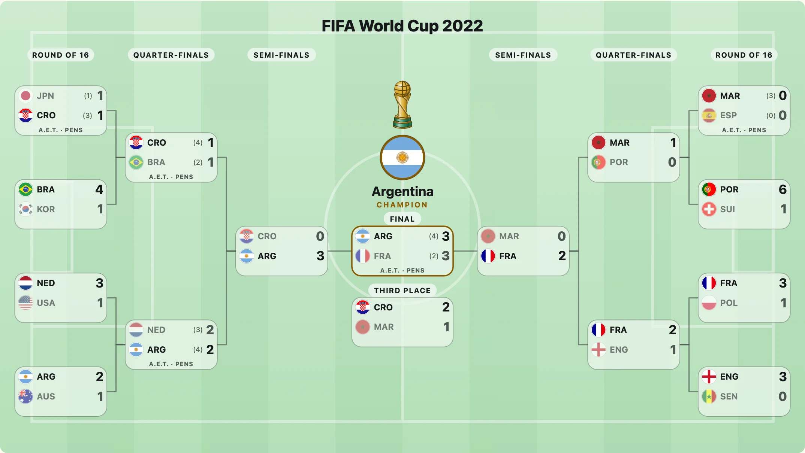

A bracket is not the same thing in every year. The NHL's first round was best of five until 1986; the NFL added a wild-card round; the World Cup has had four different knockouts. `playoffFormat(league, year)` returns the round names, the length of each series, the number of teams and the byes for a season, so a drawing says "Conference Semifinals" and "best of 7" because that is what it was called then.



## Ask for a season

```js
import { playoffFormat } from "@johnmorrisdotca/taisen-brackets";

const mlb = playoffFormat("mlb", 2022);
console.log(mlb.rounds.map((round) => `${round.name} (${round.bestOf})`).join(", ")); // Wild Card Series (3), Division Series (5), League Championship Series (7), World Series (7)
console.log(mlb.byes); // 2
console.log(playoffFormat("nhl", 1984).rounds[0].bestOf); // 5
console.log(playoffFormat("mlb", 1994)); // null
```

`null` means the league had no playoff that year (the NHL's 2005, MLB's 1994) or the package does not cover it. Do not treat a missing format as an empty one: show nothing, or say so.

## Which leagues, from when

`LEAGUES` lists them: `nhl`, `nba`, `mlb`, `nfl`, `cfl`, `mls` and `worldcup`. `playoffEras(league)` lists the eras of a league, each with the years it holds for.

```js
import { LEAGUES, playoffEras } from "@johnmorrisdotca/taisen-brackets";

console.log(LEAGUES.join(" ")); // nhl nba mlb nfl cfl mls worldcup
console.log(playoffEras("nfl").length > 1);
```

The year is the year the playoffs are played in, except for the NFL, whose year is its season's: 2024 is the season whose playoffs were played in January and February 2025. Each era was checked against English Wikipedia (facts only, cited in [formats](../formats.md), which is written from the data by `pnpm` script and lists every era).

## Use a format to draw

Give the format as `roundNames` and the rounds are named for the era; the halves are named for the conferences when the teams carry a `group` that splits them.

```js
import { drawBracket, playoffFormat } from "@johnmorrisdotca/taisen-brackets";

const svg = drawBracket(
  [
    { sides: ["FLA", "BOS"], bestOf: 7, score: [4, 2], date: "2024-05-06" },
    { sides: ["DAL", "EDM"], bestOf: 7, score: [2, 4], date: "2024-05-23" },
    { sides: ["FLA", "EDM"], bestOf: 7, score: [4, 3], date: "2024-06-08" },
  ],
  { roundNames: playoffFormat("nhl", 2024) },
);
console.log(svg.includes("Stanley Cup Final")); // true
```

## The trophy of a league

`playoffFormat(league, year).emblem` and `LEAGUE_EMBLEMS` name each league's default trophy emblem (`trophy:hockey-cup` for the NHL, `trophy:basketball` for the NBA, `trophy:soccer-globe` for the World Cup). It is drawn only when you plug in an emblem renderer; see [marks, flags and trophies](marks-flags-and-trophies.md).

```js
import { LEAGUE_EMBLEMS, playoffFormat } from "@johnmorrisdotca/taisen-brackets";

console.log(LEAGUE_EMBLEMS.nhl, playoffFormat("nhl", 2024).emblem); // trophy:hockey-cup trophy:hockey-cup
```

## Any other tournament

A league the package does not know, a club cup or a school tournament, needs no format: the rounds are named from the end ("Final", "Semi-finals", "Quarter-finals", then "Round of 16", "Round of 32"). `roundNamesFor(count)` gives the names for a bracket of that many rounds (and `roundName(remaining)` one round's), and `roundNames: ["Heats", "Final"]` replaces them with your own.

```js
import { roundNamesFor } from "@johnmorrisdotca/taisen-brackets";

console.log(roundNamesFor(4).join(", ")); // Round of 16, Quarter-finals, Semi-finals, Final
```
