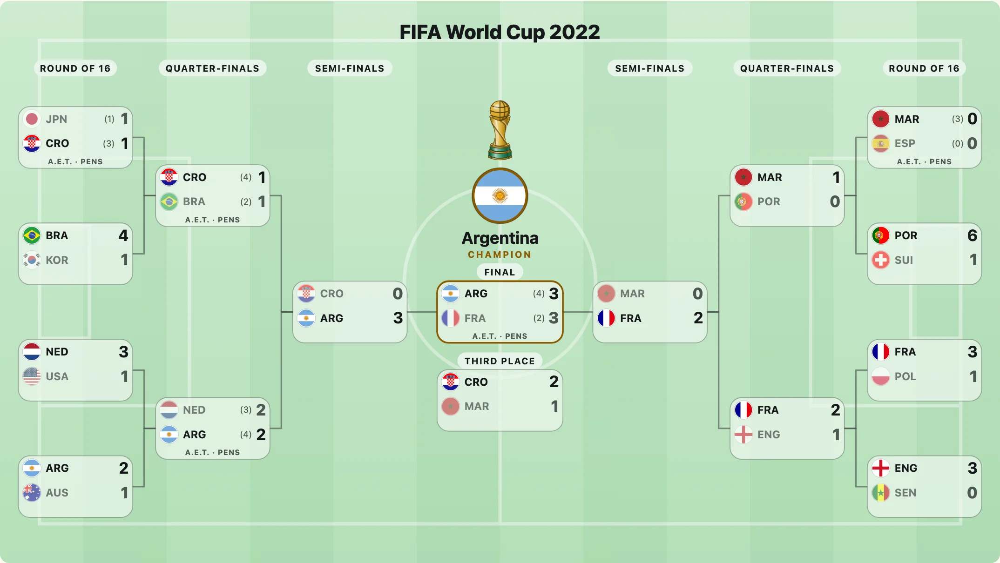

トーナメントの形は年によって違います。NHL の 1 回戦は 1986 年まで 5戦3勝制でした。NFL はワイルドカードのラウンドを加え、ワールドカップの決勝トーナメントは 4 通りありました。`playoffFormat(league, year)` は、シーズンごとのラウンド名、各シリーズの試合数、チーム数、バイを返します。そのため、当時そう呼ばれていたとおりに、「Conference Semifinals」や「best of 7」と描かれます。



## シーズンを指定する

```js
import { playoffFormat } from "@johnmorrisdotca/taisen-brackets";

const mlb = playoffFormat("mlb", 2022);
console.log(mlb.rounds.map((round) => `${round.name} (${round.bestOf})`).join(", ")); // Wild Card Series (3), Division Series (5), League Championship Series (7), World Series (7)
console.log(mlb.byes); // 2
console.log(playoffFormat("nhl", 1984).rounds[0].bestOf); // 5
console.log(playoffFormat("mlb", 1994)); // null
```

`null` は、そのリーグにその年のプレーオフがなかった（NHL の 2005 年、MLB の 1994 年）か、パッケージが対応していないことを意味します。フォーマットがないことを空のフォーマットと同じに扱わないでください。何も出さないか、そう断ってください。

## どのリーグが、いつから

`LEAGUES` が一覧を返します。`nhl`、`nba`、`mlb`、`nfl`、`cfl`、`mls`、`worldcup` です。`playoffEras(league)` は、リーグの年代ごとの区切りを、それぞれが適用される年とともに返します。

```js
import { LEAGUES, playoffEras } from "@johnmorrisdotca/taisen-brackets";

console.log(LEAGUES.join(" ")); // nhl nba mlb nfl cfl mls worldcup
console.log(playoffEras("nfl").length > 1);
```

年は、プレーオフが行われる年です。NFL だけはシーズンの年なので、2024 はプレーオフが 2025 年の 1 月と 2 月に行われたシーズンです。各年代は英語版 Wikipedia と照合してあります（事実のみ）。出典は[フォーマット](../../formats.md)にあり、そのドキュメントは `pnpm` のスクリプトでデータから生成され、すべての年代を載せています。

## フォーマットで描く

フォーマットを `roundNames` に渡すと、ラウンドがその年代の名前になります。チームの `group` がきれいに二分するときは、半分がカンファレンスの名前で呼ばれます。

```js
import { drawBracket, playoffFormat } from "@johnmorrisdotca/taisen-brackets";

const svg = drawBracket(
  [
    { sides: ["FLA", "BOS"], bestOf: 7, score: [4, 2], date: "2024-05-06" },
    { sides: ["DAL", "EDM"], bestOf: 7, score: [2, 4], date: "2024-05-23" },
    { sides: ["FLA", "EDM"], bestOf: 7, score: [4, 3], date: "2024-06-08" },
  ],
  { roundNames: playoffFormat("nhl", 2024) },
);
console.log(svg.includes("Stanley Cup Final")); // true
```

## リーグのトロフィー

`playoffFormat(league, year).emblem` と `LEAGUE_EMBLEMS` は、各リーグの既定のトロフィーのエンブレム（NHL は `trophy:hockey-cup`、NBA は `trophy:basketball`、ワールドカップは `trophy:soccer-globe`）を示します。エンブレムの描画関数を渡したときだけ描かれます。[マーク、旗、トロフィー](marks-flags-and-trophies.md)を参照してください。

```js
import { LEAGUE_EMBLEMS, playoffFormat } from "@johnmorrisdotca/taisen-brackets";

console.log(LEAGUE_EMBLEMS.nhl, playoffFormat("nhl", 2024).emblem); // trophy:hockey-cup trophy:hockey-cup
```

## ほかの大会

パッケージが知らないリーグ、クラブのカップ、学校の大会にはフォーマットが要りません。ラウンドは終わりから数えて名づけられます（「Final」「Semi-finals」「Quarter-finals」、そのあとは「Round of 16」「Round of 32」）。`roundNamesFor(count)` は、そのラウンド数のトーナメント表の名前を返します（1 ラウンドだけなら `roundName(remaining)` です）。`roundNames: ["Heats", "Final"]` で自分の名前に置き換えられます。

```js
import { roundNamesFor } from "@johnmorrisdotca/taisen-brackets";

console.log(roundNamesFor(4).join(", ")); // Round of 16, Quarter-finals, Semi-finals, Final
```
