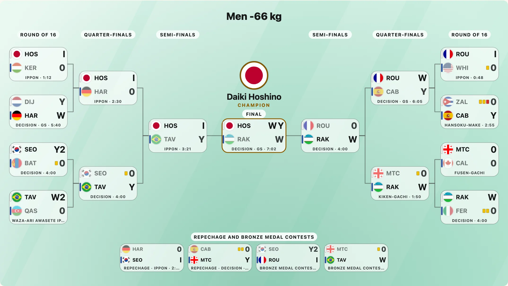

このパッケージはノックアウト方式のトーナメント表から始まりましたが、同じ描画キットが、大会のまわりのほかのグラフィックも作ります。敗者復活戦つきの柔道のトーナメント表、一試合のスコアボード、ランキング表、メダル表、テレビ風の成績ボードです。どれもサイズ、五つの言語、旗のプラグイン、そして「描画は単独の一つの SVG」という規則を共有します。このガイドでは、それぞれに短い動作例を示します。見出しのリンク先のページに、すべてのオプションがあります。



## 柔道の試合とトーナメント表

柔道の試合は、`judo` の結果を持つ対戦です。IJF の現行ルールで採点される一本、技あり、有効、指導に加え、ゴールデンスコアと試合時間を書きます。`judoOutcome` はルールに照らして確認し、誰がどう勝ったかを返します。ボックスは得点の印、カードで表した指導、二行の下の注記を書きます。`judoBracket` は、敗者復活戦と二つの銅メダル決定戦つきで、階級のトーナメント表を作ります。[柔道](../../judo.md)を参照してください。

```js
import { drawBracket, judoOutcome } from "@johnmorrisdotca/taisen-brackets";

const o = judoOutcome({ sides: [{ yuko: 2 }, { wazaAri: 1, shido: 1 }], time: "4:00" });
console.log(o.winner, o.method, o.points.join(" ")); // 1 score 2 10

const svg = drawBracket([
  { id: "a", round: 1, sides: ["Haru", "Marc"], judo: { sides: [{ ippon: true }, { shido: 1 }], time: "1:12" } },
  { id: "b", round: 1, sides: ["Levan", "Owen"], judo: { sides: [{ wazaAri: 1 }, { yuko: 1 }], goldenScore: true, time: "5:40" } },
  { id: "f", round: 2, sides: ["Haru", "Levan"], judo: { sides: [{ wazaAri: 1, yuko: 1 }, { wazaAri: 1 }], goldenScore: true, time: "7:02" } },
], { title: "Men -66 kg" });
console.log(svg.includes("tb-sh-y"), svg.includes("GS · 7:02")); // true true
```

`judoScoreboard` は、ある時点の一試合を、ボードまたは卓上のフリップカードで、三つのサイズで描きます。リアルタイムの更新は自分で行います。`judoContestCard` と `judoMatQueue` は会場向けの画面です。階級とラウンド、そして試合場ごとの大きな番号と色、順番に並んだこれからの試合を表示します。

## ランキング表

`rankingList` は、順位のあるどの競技でも、渡されたデータからランキングを、テキスト中心で描きます。写真の欄が空になることはありません。順位、旗（国、またはカナダの州の `CA-BC`）、名前、クラブ、ポイント、前回からの増減を表示します。`rankingRanks` は順位をデータとして返し、同点は同順位になります。[ランキング](../../rankings.md)を参照してください。

```js
import { rankingCategoryLabel, rankingList, rankingRanks } from "@johnmorrisdotca/taisen-brackets";

const svg = rankingList({
  category: rankingCategoryLabel({ age: "U18", sex: "men", weight: "-60" }),
  date: "October 2026",
  entries: [
    { name: { surname: "Nakamura", given: "Kenji" }, club: "Coastal Pine Judo", flag: "CA-BC", points: 412.5, change: 1 },
    { name: { surname: "Brar", given: "Harpreet" }, club: "Salmonberry Judo Club", flag: "CA-BC", points: 398, change: -1 },
  ],
}, { precision: 2, size: "portrait" });
console.log(svg.includes("U18 · Men -60 kg"), svg.includes("412.50")); // true true
console.log(rankingRanks([{ name: "A", points: 9 }, { name: "B", points: 9 }, { name: "C", points: 7 }]).join(" ")); // 1 1 3
```

長い一覧はページ分けされ（`rows`、`page`）、`rankingNumberOnes`、`rankingEntryList`、`rankingMatchup` は、各カテゴリーの 1 位、大会のエントリーリスト、直接対決のカードを描きます。

## メダル表

`medalTable` は、国やチームを金メダルの数順、または合計順に並べます。同じ行は順位を共有し（5、5、7）、かつての国は独立した行になります。`tallyMedals` は、競技、階級、大会で絞ったメダルの一覧を集計します。[メダル表](../../medals.md)を参照してください。

```js
import { medalRanks, medalTable, tallyMedals } from "@johnmorrisdotca/taisen-brackets";

const svg = medalTable({ subtitle: "Men's judo +100 kg", rows: [
  { name: "France", flag: "FR", gold: 6, silver: 1, bronze: 3 },
  { name: "Soviet Union", code: "URS", note: "1922–1991", gold: 1, bronze: 4 },
] }, { size: "portrait" });
console.log(svg.includes("Soviet Union"), svg.includes("URS")); // true true

const rows = [{ name: "A", gold: 1 }, { name: "B", gold: 1 }, { name: "C", silver: 3 }, { name: "D", silver: 1 }];
console.log(medalRanks(rows).join(" "), "|", medalRanks(rows, { sort: "total" }).join(" ")); // 1 1 3 4 | 1 2 2 4
console.log(typeof tallyMedals);
```

## 放送用ボード

`resultsBoard` は成績のグラフィックを描きます。タイトルの帯、枠に入った順位、国コード、4:3 の旗、名前、記録のバッジ（`OR`、`WR`、`NR`）、その競技固有の精度のスコアやタイムの列です。`boutBoard` は試合紹介を、`broadcastMedalTable` はメダル表を、いずれも画像の上に重ねられる単独の SVG として描きます。三つの見た目があり、どの大会のロゴも含みません。サイズは行数から決まります。[放送用ボード](../../broadcast.md)を参照してください。

```js
import { resultsBoard, resultsBoardSize } from "@johnmorrisdotca/taisen-brackets";

const source = {
  title: "Men's 100m butterfly",
  phase: "Results · Final",
  columns: [{ precision: 2 }],
  rows: [
    { code: "USA", flag: "US", name: "Michael Phillips", values: [50.58], record: "OR" },
    { code: "HUN", flag: "HU", name: "Laszlo Czigany", values: [50.59] },
  ],
};
console.log(resultsBoard(source, { width: 960 }).includes("50.58"), JSON.stringify(resultsBoardSize(source.rows.length, { width: 960 })));
```

これらすべての旗は、トーナメント表と同じプラグインです。`flags` を渡せば、各行のコードが描かれます。どれも特定の大会や連盟には依存しません。
