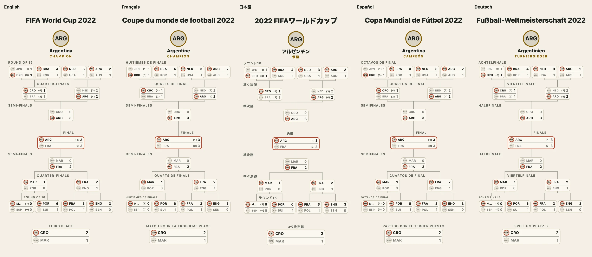

ワールドカップは多くの言語で読まれ、トーナメント表は見えない人にも読まれます。どちらも言葉の問題です。パッケージが書くすべての文章（ラウンド名、注記、優勝者のラベル、表の見出し、説明）は言葉の表にあり、五つの言語それぞれに表が一つずつあります。このガイドでは、言語の選び方、その言語でチームを呼ぶ方法、自分の言語の足し方、スクリーンリーダーが受け取るものを説明します。



## 言語を選ぶ

`locale` は `"en"`（既定）、`"fr"`、`"ja"`、`"es"`、`"de"`、または自分で作った `Locale` です。言葉、ラウンド名、`<svg>` と `<table>` の `lang`、数字と日付（`Intl`）、そして言語の規則による大文字（日本語には適用されません）が決まります。

```js
import { countryName, describeBracket } from "@johnmorrisdotca/taisen-brackets";

const teams = [{ id: "ARG", name: "Argentina", region: "AR" }, { id: "FRA", name: "France", region: "FR" }];
const matchups = [{ sides: ["ARG", "FRA"], score: [3, 3], extraTime: true, pens: [4, 2], date: "2022-12-18" }];
// A country's name in the language comes from Intl, by its ISO code: there is no list of names to write.
const teamName = (team, locale) => team.region && countryName(team.region, locale);

for (const locale of ["en", "ja"]) console.log(describeBracket({ matchups, teams }, { locale, teamName }));
// 2 teams, 1 round. Final: Argentina 3, France 3 (after extra time, 4–2 on penalties). Winner: Argentina. Champion: Argentina.
// 2チーム、1ラウンド。決勝：アルゼンチン 3–3 フランス（延長戦、PK戦 4–2）。勝者：アルゼンチン。優勝：アルゼンチン。
```

## チームの呼び方

チームには `names: { fr: "Allemagne", ja: "ドイツ" }` のように名前を持たせられます。オプション `teamName(team, locale)` で名前を返すこともでき、`countryName("DE", locale)` は `Intl.DisplayNames` から国名を作ります。イングランドなどの `GB-ENG`、`GB-SCT`、`GB-WLS`、`GB-NIR` も同様です。クラブはどの言語でも自分の名前のままで、チームの略称はどこでも同じです。`localizedLayout(layout, voice)` は、チーム名がすでに言語に直されたレイアウトを返すので、自分で描くコードに使えます。

```js
import { countryName } from "@johnmorrisdotca/taisen-brackets";

console.log(countryName("DE", "en"), countryName("DE", "fr"), countryName("DE", "ja")); // Germany Allemagne ドイツ
```

## ラウンド名と自分の言葉

ラウンド名は、各言語の Wikipedia のワールドカップの記事にあるサッカー用語です（*Huitièmes de finale*、*Octavos de final*、*Achtelfinale*、ラウンド16）。各リーグのラウンドは一般的な語を翻訳したもので、リーグ自身の名前はその言語で使われる形のままです。`words` はどの言語のどの文字列も置き換えられ、`WORDS` が英語の語を持っています。

```js
import { WORDS, drawBracket } from "@johnmorrisdotca/taisen-brackets";

console.log(typeof WORDS.champion);
const svg = drawBracket([{ sides: ["A", "B"], score: [2, 1] }], { locale: "fr", words: { champion: "Vainqueur" } });
console.log(svg.includes("VAINQUEUR"), svg.includes('lang="fr"')); // true true
```

## 自分の言語

`defineLocale` は、書かなかった部分を英語で補います。その結果を `locale` に渡します。

```js
import { defineLocale, drawBracket } from "@johnmorrisdotca/taisen-brackets";

const dutch = defineLocale("nl", { words: { champion: "Kampioen" }, rounds: { Final: "Finale" } });
const svg = drawBracket([{ sides: ["A", "B"], score: [2, 1] }], { locale: dutch });
console.log(svg.includes("KAMPIOEN"), svg.includes('lang="nl"')); // true true
```

スペイン語とドイツ語の語は Wikipedia と照合しただけで、ネイティブの読み手が必要です。フランス語と日本語は、それぞれの言語のネイティブのレビュアーが読んでいます。すべての語の表は[言語](../../languages.md)にあります。

## スクリーンリーダーが受け取るもの

- `<svg>` は `role="img"` で、チーム数とラウンド数、決勝、優勝者を伝える `<title>` と `<desc>` で名前が付けられます。各対戦にはツールチップの文があります（`Argentina 3, France 3 (a.e.t., pens 4-2). Winner: Argentina`）。
- 勝者は色だけでなく、太字とリングで示されます。
- テキストはどの背景の上でも 4.5 対 1 のコントラストを保ち、何もボックスからはみ出しません。ジオメトリのテストが、すべての例、サイズ、見た目を測っています。
- ボックスのリンクは本物の `<a>` 要素で、アクセシブルな名前と、ホバー時の表示、フォーカスリングを持ちます。

`describeBracket` は、ほかの場所（キャプションや `alt`）に使える説明を返し、`bracketTable` はトーナメント表全体を、キャプションと見出しセルを持つ HTML の表として返します。

```js
import { bracketTable, describeBracket } from "@johnmorrisdotca/taisen-brackets";

const bracket = [{ sides: ["Aurora", "Harbour"], score: [2, 1] }];
console.log(describeBracket(bracket)); // 2 teams, 1 round. Final: Aurora 2, Harbour 1. Winner: Aurora. Champion: Aurora.
console.log(bracketTable(bracket, { locale: "fr" }).includes('lang="fr"')); // true
```

表には注記も書かれます（`a.e.t.`、`pens 4–2`、`agg.`、`in 7`）。何も動かず、描画にスクリプトはなく、通信もしません。
