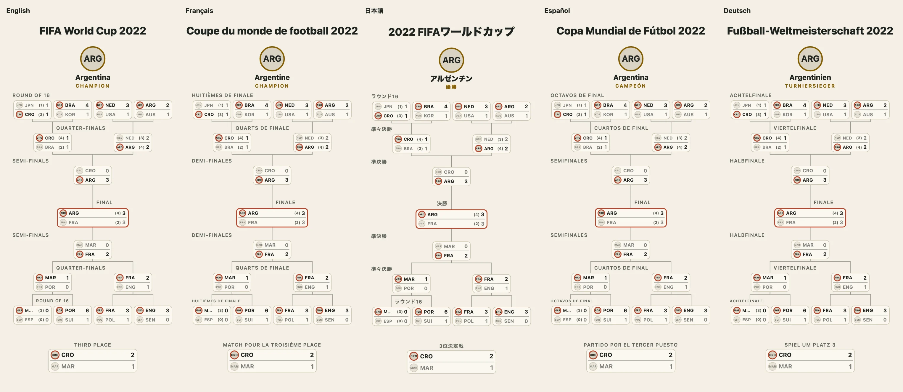

A World Cup is read in many languages, and a bracket is read by people who cannot see it. Both come down to words: every text the package writes, the round names, the notes, the champion's label, the table's headers and the description, is in a table of words, and there is one table for each of five languages. This guide shows how to choose one, how to name a team in it, how to add a language of your own and what a screen reader gets.



## Choose a language

`locale` is `"en"` (the default), `"fr"`, `"ja"`, `"es"`, `"de"` or a `Locale` you made. It sets the words, the names of the rounds, the `lang` of the `<svg>` and the `<table>`, the digits and the dates (through `Intl`), and capitals by the language's rules (not for Japanese).

```js
import { countryName, describeBracket } from "@johnmorrisdotca/taisen-brackets";

const teams = [{ id: "ARG", name: "Argentina", region: "AR" }, { id: "FRA", name: "France", region: "FR" }];
const matchups = [{ sides: ["ARG", "FRA"], score: [3, 3], extraTime: true, pens: [4, 2], date: "2022-12-18" }];
// A country's name in the language comes from Intl, by its ISO code: there is no list of names to write.
const teamName = (team, locale) => team.region && countryName(team.region, locale);

for (const locale of ["en", "ja"]) console.log(describeBracket({ matchups, teams }, { locale, teamName }));
// 2 teams, 1 round. Final: Argentina 3, France 3 (after extra time, 4–2 on penalties). Winner: Argentina. Champion: Argentina.
// 2チーム、1ラウンド。決勝：アルゼンチン 3–3 フランス（延長戦、PK戦 4–2）。勝者：アルゼンチン。優勝：アルゼンチン。
```

## Naming teams

A team can carry its names (`names: { fr: "Allemagne", ja: "ドイツ" }`), the option `teamName(team, locale)` can give one, and `countryName("DE", locale)` makes a country's name from `Intl.DisplayNames`, the home nations `GB-ENG`, `GB-SCT`, `GB-WLS` and `GB-NIR` too. A club keeps its own name in every language; a team's short name is the same everywhere. `localizedLayout(layout, voice)` gives a layout with the names already in a language, for code that draws its own.

```js
import { countryName } from "@johnmorrisdotca/taisen-brackets";

console.log(countryName("DE", "en"), countryName("DE", "fr"), countryName("DE", "ja")); // Germany Allemagne ドイツ
```

## Round names and your own words

The round names are the football terms of each language's Wikipedia article on the World Cup (*Huitièmes de finale*, *Octavos de final*, *Achtelfinale*, ラウンド16); the leagues' rounds are the generic words translated, and a league's own name keeps the form the language uses. `words` replaces any string of any language, and `WORDS` holds the English.

```js
import { WORDS, drawBracket } from "@johnmorrisdotca/taisen-brackets";

console.log(typeof WORDS.champion);
const svg = drawBracket([{ sides: ["A", "B"], score: [2, 1] }], { locale: "fr", words: { champion: "Vainqueur" } });
console.log(svg.includes("VAINQUEUR"), svg.includes('lang="fr"')); // true true
```

## A language of your own

`defineLocale` fills what you leave out from English; pass the result as `locale`.

```js
import { defineLocale, drawBracket } from "@johnmorrisdotca/taisen-brackets";

const dutch = defineLocale("nl", { words: { champion: "Kampioen" }, rounds: { Final: "Finale" } });
const svg = drawBracket([{ sides: ["A", "B"], score: [2, 1] }], { locale: dutch });
console.log(svg.includes("KAMPIOEN"), svg.includes('lang="nl"')); // true true
```

The Spanish and German words were checked against Wikipedia only and need a native reader; the French and Japanese were read by native reviewers. See [languages](../languages.md) for the table of every word.

## What a screen reader gets

- The `<svg>` is `role="img"`, labelled by a `<title>` and a `<desc>` that say how many teams and rounds there are, the final and the champion. Each tie has a tooltip sentence ("Argentina 3, France 3 (a.e.t., pens 4-2). Winner: Argentina").
- The winner is marked by weight and a ring, not by colour alone.
- Text keeps a contrast of 4.5 to 1 over every background, and nothing sticks out of its box: a geometry test measures every example, size and look.
- Links on boxes are real `<a>` elements with accessible names, a hover and a focus ring.

`describeBracket` gives you the description for any other place (a caption, an `alt`), and `bracketTable` the whole bracket as an HTML table with a caption and header cells.

```js
import { bracketTable, describeBracket } from "@johnmorrisdotca/taisen-brackets";

const bracket = [{ sides: ["Aurora", "Harbour"], score: [2, 1] }];
console.log(describeBracket(bracket)); // 2 teams, 1 round. Final: Aurora 2, Harbour 1. Winner: Aurora. Champion: Aurora.
console.log(bracketTable(bracket, { locale: "fr" }).includes('lang="fr"')); // true
```

The table writes the note as well ("a.e.t.", "pens 4–2", "agg.", "in 7"). Nothing moves, there is no script in a drawing, and no network request is made.
