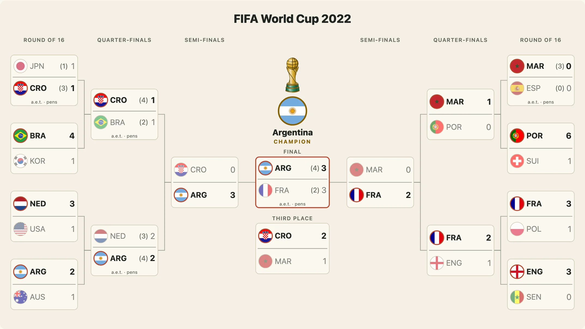

The same ties can be drawn many ways. This guide separates the six choices that are independent of each other: the **size** of the picture, the **shape** of the tree, the **layout** (tree, rows, shields and the rest), the **look** (classic or road), the **theme** (light, dark, poster) and the **background**. Any combination works.



## Size and shape

```js
import { drawBracket } from "@johnmorrisdotca/taisen-brackets";

const bracket = [
  { sides: ["A", "B"], score: [1, 0], date: "1" }, { sides: ["C", "D"], score: [0, 2], date: "1" }, { sides: ["A", "D"], score: [2, 1], date: "2" },
];

const views = {
  wide: drawBracket(bracket),
  square: drawBracket(bracket, { size: "square" }),
  card: drawBracket(bracket, { size: "card" }),
  phone: drawBracket(bracket, { size: "phone" }),
  custom: drawBracket(bracket, { size: { width: 800, height: 500 } }),
  ltr: drawBracket(bracket, { shape: "ltr" }),
};
console.log(Object.keys(views).map((name) => /viewBox="0 0 (\d+) /.exec(views[name])[1]).join(" ")); // 1200 1080 1080 390 800 1200
```

`wide` is 1200 × 675, `square` 1080 × 1080, `card` 1080 × 1350 (a tall post, the rounds as rows) and `phone` 390 wide and as tall as it needs. `shape: "ltr"` draws one tree, left to right, with the champion at the end; the default is two halves meeting at the final. `detail` is `full` (names and scores), `compact` (abbreviations), `mark` (only the marks) or `auto`, which takes the fullest one that fits.

## Theme

`theme: "auto"` (the default) draws the light look and follows the page: under `prefers-color-scheme: dark`, or `<html data-theme="dark">`, it is the dark one. `light`, `dark` and `poster` (gold on navy) fix it; `none` writes no `<style>` so your own CSS draws it, with `currentColor` as the fallback. Every colour is `var(--tb-<name>, <the look's value>)`, so a page restyles a drawing from outside.

```js
import { drawBracket } from "@johnmorrisdotca/taisen-brackets";

const svg = drawBracket([{ sides: ["A", "B"], score: [1, 0] }]);
console.log(svg.includes("var(--tb-ink"), drawBracket([{ sides: ["A", "B"], score: [1, 0] }], { theme: "none" }).includes("<style>")); // true false
```

```css
.my-bracket { --tb-ink: #123; --tb-win: #c60; --tb-box: #fff; --tb-line: #99a; }
```

The names are `bg`, `ink`, `muted`, `line`, `box`, `edge`, `win`, `gold`, `plain` and `font`.

## The road look

`look: "road"` draws large round marks with a wide ring, big bold scores in which the loser's is quiet, the rounds on pills, and, with `highlightPath`, one team's way through the bracket as a dotted line. `seeds`, `codes` and `vs` add tags to it.

```js
import { drawBracket } from "@johnmorrisdotca/taisen-brackets";

const bracket = [
  { sides: ["A", "B"], score: [1, 0], date: "1" }, { sides: ["C", "D"], score: [0, 2], date: "1" }, { sides: ["A", "D"], score: [2, 1], date: "2" },
];
const svg = drawBracket(bracket, { look: "road", size: "card", highlightPath: "A" });
console.log(svg.includes("tb-look-road"), (svg.match(/class="tb-line tb-path"/g) ?? []).length); // true 1
```

## Nine layouts

`layout` is `tree` (the default), `rows`, `shields`, `update`, `columns`, `playin`, `series`, `groups` or `picture`. Each takes the same `background`, `look`, `size`, `locale`, `href` and `flags`.

| `layout` | What it draws |
| --- | --- |
| `tree` | the halves meeting at the final |
| `rows` | each team a row: a name, a mark and a result slot |
| `shields` | the teams as shields |
| `update` | a score-update card |
| `columns` | tall columns in two conference colours |
| `playin` | the NBA's play-in, with winners' and losers' arrows |
| `series` | a series card, with the length under each column |
| `groups` | the group tables, from round-robin games (`round: 0`) |
| `picture` | the postseason picture: logo tiles with seeds, the result beside each pair |

```js
import { LAYOUTS, drawBracket } from "@johnmorrisdotca/taisen-brackets";

const bracket = [{ sides: ["A", "B"], score: [1, 0], date: "1" }, { sides: ["C", "D"], score: [0, 2], date: "1" }, { sides: ["A", "D"], score: [2, 1], date: "2" }];
console.log(LAYOUTS.join(" ")); // tree rows shields update columns playin series groups picture
console.log(drawBracket(bracket, { layout: "rows" }).startsWith("<svg"));
```

[Layouts](../layouts.md) has a picture and the needs of each.

## Backgrounds

`background` draws a poster background under the bracket. There are twenty-five, all drawn in code, each in a dark and a light variant: gradients, glows, patterns and the markings of a playing surface (`pitch`, `ice`, `hardwood`, `infield`, `turf`). The text, lines and boxes take the colours that read over it, at 4.5 to 1, held by a test.

```js
import { BACKGROUND_PRESETS, contrastRatio, drawBracket } from "@johnmorrisdotca/taisen-brackets";

const ties = [{ sides: ["VAN", "NSH"], score: [4, 3], round: 1, seeds: ["P1", "WC2"] }, { sides: ["EDM", "LAK"], score: [1, 2], round: 1 }, { sides: ["VAN", "LAK"], score: [2, 1], round: 2 }];
const ice = drawBracket(ties, { look: "road", background: "ice", seeds: true });
const mine = drawBracket(ties, { look: "road", theme: "dark", background: { preset: "swirl", colors: ["#10203a", "#3a1060", "#ff7ac8", "#6ae0ff"], angle: 135, intensity: 0.8 } });
const photo = drawBracket(ties, { look: "road", theme: "dark", background: { image: "stadium.jpg", fit: "cover", dim: 0.55 } });
console.log(BACKGROUND_PRESETS.length, ice.includes("tb-bgd"), mine.includes("#ff7ac8"), photo.includes('<image href="stadium.jpg"')); // 25 true true true
console.log(contrastRatio([0, 0, 0], [255, 255, 255])); // 21
```

A picture of your own is `http(s)`, a relative path or `data:image/` only; anything else is dropped. `background: false` leaves it transparent. The details and the contrast rules are in [backgrounds](../backgrounds.md).
