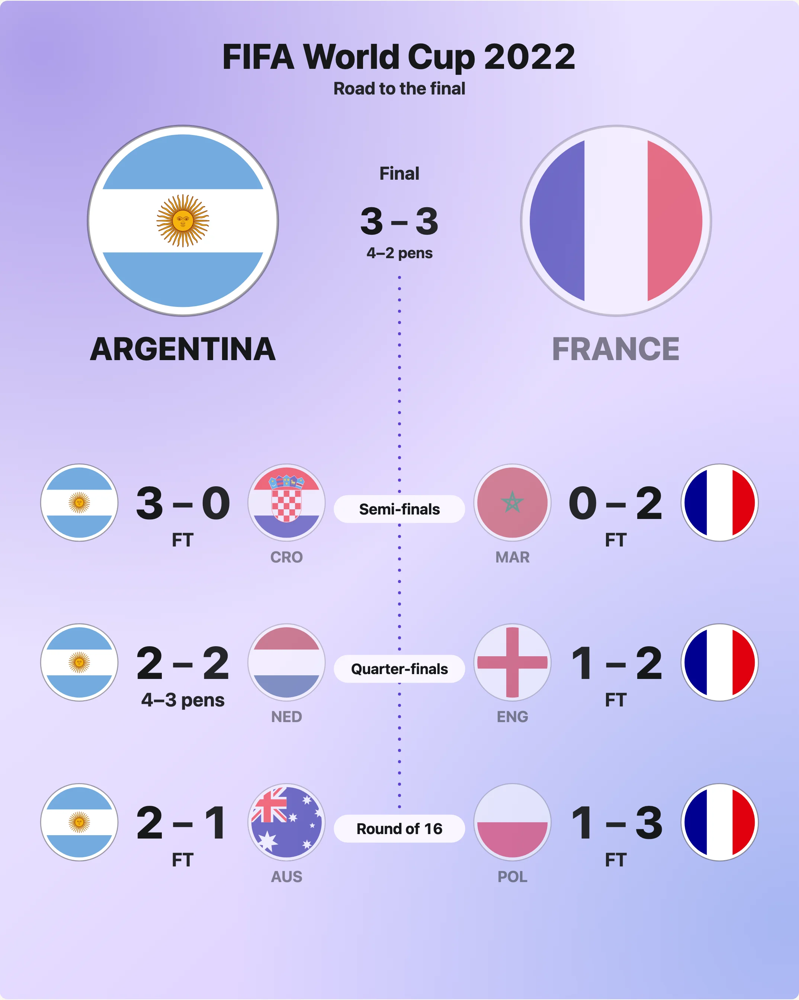

A bracket of names is a table. What makes it a picture is each team's mark, a flag or a crest, and the champion in the middle with a cup. None of them is a dependency of the package: you bring the marks, the package draws them safely and writes each once. This guide covers the four things you can bring.



## A mark of your own

A team's `mark` is an image address (`https://`, `data:image/` or a relative path) or inline SVG. It is drawn in a circle (`markShape: "round"`, the default), a square, or left out (`"none"`). A team with no mark is its initials on its `color`, so nothing looks missing. In the road look a team with no mark is a rounded tile with its letters.

```js
import { drawBracket } from "@johnmorrisdotca/taisen-brackets";

const teams = [
  { id: "AUR", name: "Aurora", color: "#2f5d4a", mark: "https://example.com/aurora.svg" },
  { id: "HAR", name: "Harbour", color: "#1d4f91" },
];
const svg = drawBracket({ teams, matchups: [{ sides: ["AUR", "HAR"], score: [2, 1] }] }, { look: "road" });
console.log(svg.includes("https://example.com/aurora.svg"), svg.includes(">HAR")); // true true
```

Every mark address is written once, as a `<symbol>`, and used wherever the team appears; a long `data:` image is not repeated per use.

## Safe by construction

Inline SVG is cleaned as it goes in: scripts, event attributes, `<style>`, `<foreignObject>` and `javascript:` addresses are removed, and an image address must be http(s), relative or `data:image/`. The same rules are exported, so you can use them for your own markup.

```js
import { cleanSvg, safeHref, safeUrl } from "@johnmorrisdotca/taisen-brackets";

const cleaned = cleanSvg('<svg viewBox="0 0 1 1"><script>alert(1)</script><path d="M0 0h1v1z" onclick="x()"/></svg>');
console.log(cleaned.viewBox, cleaned.inner.includes("script"), cleaned.inner.includes("onclick")); // 0 0 1 1 false false
console.log(safeUrl("javascript:alert(1)"), safeHref("/team/ARG")); // false true
```

An address you pass is loaded by the visitor's browser; the package makes no request itself.

## Flags from a plug-in

A team can carry a country code, `flag: "AR"`, and the drawing asks the `flags` function you pass for its picture: any synchronous function from a code and a request (`{ shape, size, theme }`) to an SVG string, or to nothing for a code it has no flag for. Hata's round flags are the one to use; load them first, since its `flag()` is asynchronous.

```js
import { drawBracket } from "@johnmorrisdotca/taisen-brackets";
import { flag } from "@johnmorrisdotca/hata/load";

const loaded = { AR: await flag("AR", { shape: "round" }), FR: await flag("FR", { shape: "round" }) };
const teams = [{ id: "ARG", name: "Argentina", flag: "AR" }, { id: "FRA", name: "France", flag: "FR" }];
const matchups = [{ sides: ["ARG", "FRA"], score: [3, 3], extraTime: true, pens: [4, 2] }];

const svg = drawBracket({ teams, matchups }, { flags: (code) => loaded[code], look: "road" });
console.log(svg.includes("<symbol")); // true
```

Without a renderer, or when it returns nothing for a code, throws, or returns something that is not an `<svg>`, the team's `mark` is drawn, or its initials. It never throws. For a page that cannot afford an inline flag of 80 kB twice, `flagHref(code)` gives a flag as an address to load.

## The champion and a trophy

Once the final is played the champion is in the centre with the word "Champion" (on a phone, at the top, so that no line runs through it). Pass your own trophy, inline SVG or an image address, as `trophy`; `champion: false` leaves the centre out.

```js
import { drawBracket } from "@johnmorrisdotca/taisen-brackets";

const trophy = '<svg viewBox="0 0 24 24"><path d="M6 3h12v5a6 6 0 0 1-12 0zM10 14h4v4h3v3H7v-3h3z" fill="currentColor"/></svg>';
console.log(drawBracket([{ sides: ["A", "B"], score: [2, 1] }], { trophy }).includes('class="tb-gold"')); // true
```

## An emblem from Dougu Sports

The trophy can also be an emblem id, such as `"trophy:hockey-cup"`, drawn by a function you pass as `emblems`: any function from an id and a request (`{ style, size, tint, theme }`) to an SVG string. `renderEmblem` from `@johnmorrisdotca/dougu-sports/emblems` is one.

```js
import { drawBracket } from "@johnmorrisdotca/taisen-brackets";
import { renderEmblem } from "@johnmorrisdotca/dougu-sports/emblems";

const svg = drawBracket([{ sides: ["Aurora", "Harbour"], score: [2, 1] }], { emblems: renderEmblem, trophy: "trophy:hockey-cup" });
console.log(svg.includes('class="tb-emblem"')); // true
```

- The renderer is asked for the size the trophy has in the drawing, and for `theme: "light"` or `"dark"` when the bracket is in that look (`"dark"` for `poster`), else `"inherit"`, where the drawing's own colour (`--tb-ink`) is the ink. `emblemStyle` (`"metal"`, the default, `"line"` or `"color"`) and `emblemTint` (a hex colour) are passed on.
- Without a renderer an emblem id draws nothing and takes no room. A renderer that throws, or returns something that is not an `<svg>`, draws no trophy.
- There is no global switch: a drawing is a pure function of its options, so the renderer is passed to each call.

## A link on every box

`href` is called for each tie with the tie alone. An address makes the whole box a link; with none, it is called for each side (`0` and `1`) and a team's row with an address is a link of its own. Each is a real `<a href>` in the SVG with an accessible name (the tooltip's sentence), a hover and a focus ring.

```js
import { drawBracket } from "@johnmorrisdotca/taisen-brackets";

const bracket = [{ sides: ["A", "B"], score: [1, 0], date: "1" }, { sides: ["C", "D"], score: [0, 2], date: "1" }, { sides: ["A", "D"], score: [2, 1], date: "2" }];
const boxes = drawBracket(bracket, { href: (tie) => `/match/${tie.id}` });
console.log(boxes.match(/<a /g).length, boxes.includes('href="/match/m3"')); // 3 true
```

An address must be http(s), relative or a `#` fragment; `javascript:` is dropped.
